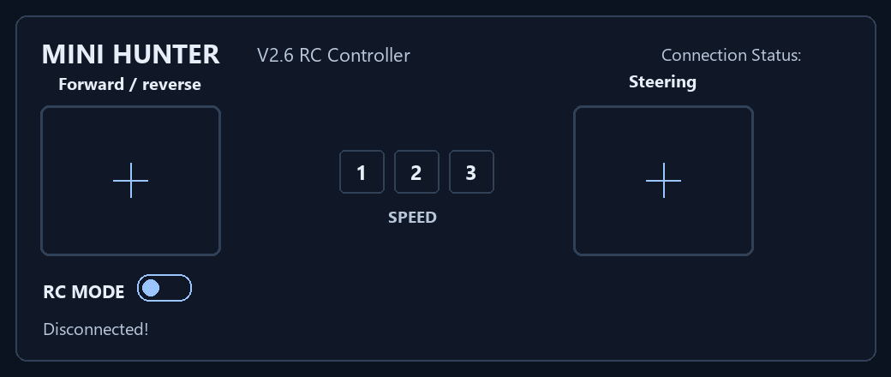

# Bluetooth application setup

Choose the app that matches the **firmware installed on your Mini Hunter**.



<div class="card-grid">
  <a class="guide-card" href="bluetooth-sinyas-v2-8.html"><span class="status-chip ready">New · V2.8</span><strong>Sinyas setup</strong><span>Pair the Bluetooth module, connect in Sinyas, and test Drive.</span></a>
  <a class="guide-card" href="#v27-bluetooth-electronics"><span class="status-chip ready">Old · V2.7</span><strong>Bluetooth Electronics setup</strong><span>Install the legacy app and import the supplied control panel.</span></a>
</div>

## Old guide · V2.7 Bluetooth Electronics
{: #v27-bluetooth-electronics}

<span class="status-chip in-progress">In progress — written steps are available; supporting images are still being added</span>

This guide prepares an Android phone to control a Mini Hunter running compatible **V2.7 firmware** through **Bluetooth Electronics**. The supplied panel is named **MiniHunterV2.6-BTController.kwl**. Complete the [Arduino IDE and board setup](setup-and-first-upload.html) first if you need to install the firmware.

<div class="warning note"><strong>Before the robot moves:</strong> place it on a stable stand so the wheels and blade cannot touch the table, floor, clothing, cables, or hands.</div>

### Downloads

Use these copies together so the Android application and Mini Hunter panel stay easy to find:

<div class="download-list">
  <a class="download-item" href="../downloads/mini-hunter/bluetooth/Bluetooth-Electronics.apk" download>
    <strong>Download Bluetooth Electronics</strong>
    <span>Android APK · 7.6 MB</span>
  </a>
  <a class="download-item" href="../downloads/mini-hunter/bluetooth/panel/MiniHunterV2.6-BTController.kwl" download>
    <strong>Download the Mini Hunter V2.6 panel</strong>
    <span>Final control-panel file · KWL</span>
  </a>
</div>

The earlier `MiniHunterV2-RCV2.kwl` file is retained only in the repository under `panel/.old/`. It is intentionally not linked as a user download. Use **MiniHunterV2.6-BTController.kwl** for this guide.

### What you need

- An Android phone or tablet with Bluetooth.
- The `Bluetooth-Electronics.apk` installer supplied by Twentynine Robotics.
- The final `MiniHunterV2.6-BTController.kwl` control-panel file.
- A charged Mini Hunter with firmware that supports Bluetooth mode.

This guide uses only the final Mini Hunter V2.6 panel. Keep the panel file and robot firmware on the same release.

> **Supporting image coming later — MH-BT-01**
> The three required items: Android device, application file, and Mini Hunter panel file.

### 1 Install and open the app

1. Download the supplied APK on the Android device.
2. Tap the APK and follow Android's installation prompts. Android may ask you to allow installation from that file source.
3. Open **Bluetooth Electronics** once.
4. Allow Bluetooth or **Nearby devices** permission when asked.
5. Close the app after its first launch. This normally creates a folder named `keuwlsoft` in internal storage.

Only install the APK from the Twentynine Robotics download above or the matching copy supplied with your robot.

### 2 Put the panel file in the correct folder

1. Open the Android **Files** app.
2. Find `MiniHunterV2.6-BTController.kwl`, usually in **Downloads**.
3. Move or copy it to the `keuwlsoft` folder at the top level of internal storage.
4. Keep the folder name exactly lowercase: `keuwlsoft`.
5. If the folder was not created, create it using that exact name.

Your final file location should resemble:

```text
Internal storage/
  keuwlsoft/
    MiniHunterV2.6-BTController.kwl
```

> **Supporting image coming later — MH-BT-02**
> Android Files showing `MiniHunterV2.6-BTController.kwl` inside the lowercase `keuwlsoft` folder.

### 3 Import the control panel

1. Open **Bluetooth Electronics**.
2. Open a blank panel.
3. Tap **Edit**.
4. Open **Import/Export**.
5. Choose **Import panel**.
6. Select `MiniHunterV2.6-BTController.kwl`.
7. Confirm that the Mini Hunter controls appear.

<figure class="guide-figure step-figure">
  <a href="../assets/images/mini-hunter/legacy-bluetooth-panel-map.png"></a>
  <figcaption><strong>Imported panel map.</strong> Use RC MODE to enable control. This diagram is based on the supplied panel file.</figcaption>
</figure>

Do not rename buttons or change the commands they send unless you are also updating the matching firmware. A button can look correct while sending a command the robot does not understand.

### 4 Connect and perform a safe test

1. Support the robot with its moving parts clear.
2. Power on the robot.
3. Select **BT MODE** on the robot.

    <figure class="guide-figure guide-figure--compact step-figure">
      <a href="../assets/images/mini-hunter/oled/v27-bt-running.png"></a>
      <figcaption><strong>On the robot.</strong> Tap SW2 to enter BT Mode. The OLED shows RUNNING while it waits for Bluetooth Electronics.</figcaption>
    </figure>

4. In the app, choose the robot's Bluetooth module and connect.
5. Enter **Run** mode in the app. Turn on **RC MODE** on the imported panel to enable control.

    <figure class="guide-figure guide-figure--compact step-figure">
      <a href="../assets/images/mini-hunter/oled/v27-bt-connected.png"></a>
      <figcaption><strong>On the robot.</strong> CONNECTED appears after the panel’s RC MODE switch sends the enable command.</figcaption>
    </figure>

6. Press one control briefly, then release it.
7. Verify the expected response before testing another control.
8. Test **Stop** early so you know how to stop movement.

If the phone connects but the robot does not respond, first confirm that the imported panel and robot firmware belong to the same release. Then check [troubleshooting](troubleshooting/#bluetooth-connects-but-controls-do-nothing).

### Important do's and don'ts

<div class="do-dont">
  <div><h3>Do</h3><ul><li>Test with wheels and blade clear.</li><li>Use one control at a time.</li><li>Keep the original panel file as a backup.</li><li>Disconnect before changing wiring or attachments.</li></ul></div>
  <div><h3>Don't</h3><ul><li>Do not install an APK from an unknown source.</li><li>Do not assume every panel works with every firmware version.</li><li>Do not edit panel commands casually.</li><li>Do not hold a movement button during the first test.</li></ul></div>
</div>
