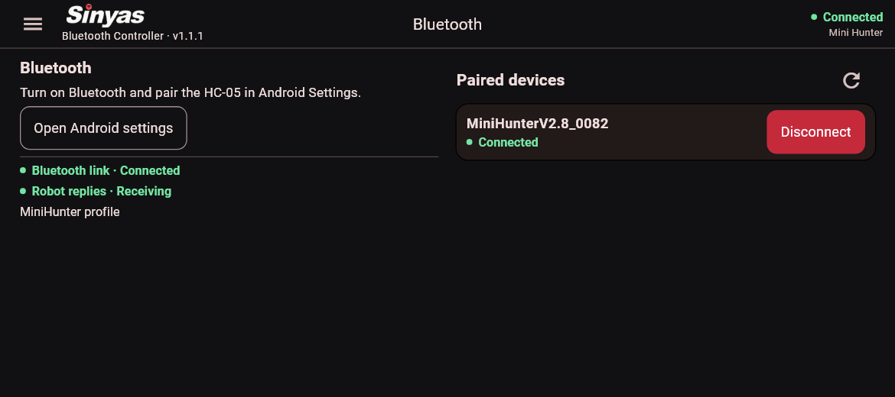
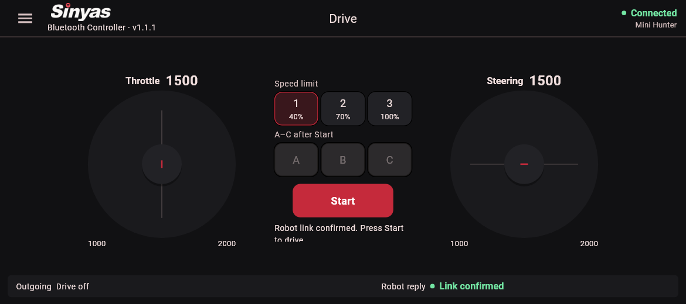

# V2.8 Bluetooth setup with Sinyas

Use this guide for Mini Hunter running **MiniHunterV2.8_Advance**. If your robot still runs V2.7, follow the [Bluetooth Electronics setup](bluetooth-application-setup.html#v27-bluetooth-electronics).



## What you need

- A Mini Hunter with its Bluetooth module connected
- An Android phone with Android 7.0 or later
- A secure stand that keeps the wheels and moving parts clear

## 1 Install Sinyas and pair the module



1. Download the current Sinyas APK from the [release page](../sinyas/releases.html). Install it and allow **Nearby devices** access when Android asks.
2. Put the robot on its stand and power it on. In Sinyas, open **☰ → Bluetooth → Open Android settings**.
3. Turn on Bluetooth. Select the device with your robot's serial number and enter its configured PIN if Android prompts you.
4. Return to Sinyas. If the module is missing under **Paired devices**, tap Refresh.

## 2 Put the Mini Hunter in Bluetooth Drive

1. Set the robot's **MODE** switch to **REMOTE**. Tap **SW1** until the OLED shows **BT MODE**.
2. Tap and release **SW2**. The OLED should now say **Waiting for Sinyas**.

    <figure class="guide-figure guide-figure--compact step-figure">
      
      <figcaption><strong>Waiting for Sinyas.</strong> The board is ready to receive commands from the app.</figcaption>
    </figure>

## 3 Connect in the app

1. In the Sinyas **Bluetooth** screen, tap **Connect** beside your paired module.
2. Wait for **Connected** and the **Mini Hunter** profile. **Connected** confirms the phone reached the module. The profile name confirms the robot's firmware replied.

    <figure class="guide-figure step-figure">
      
      <figcaption><strong>In Sinyas.</strong> This example shows serial 0082. Choose your own robot’s Bluetooth name and check the Mini Hunter profile before opening Drive.</figcaption>
    </figure>

3. If the profile stays on **Generic**, check that the OLED is in BT Mode and the robot has the compatible firmware, then reconnect.

## 4 Test Drive on the stand

1. Open **Drive**, choose your lowest speed preset, and tap **Start**. Keep the sticks centered until the board confirms the drive session.

    <figure class="guide-figure step-figure">
      
      <figcaption><strong>In Sinyas.</strong> Wait for Link confirmed before pressing Start. The centered sticks read 1500.</figcaption>
    </figure>

2. Move the throttle a little, then release it and check that the wheels stop. Repeat with the steering stick.
3. Hold **Stop** for two seconds to end the session. Confirm both wheels are stopped before picking up the robot.

Read the [full Sinyas Mini Hunter walkthrough](../sinyas/mini-hunter.html) for more OLED examples and troubleshooting. To adjust the robot's settings, open the [V2.8 calibration guide](calibration/sinyas-v2-8.html).
