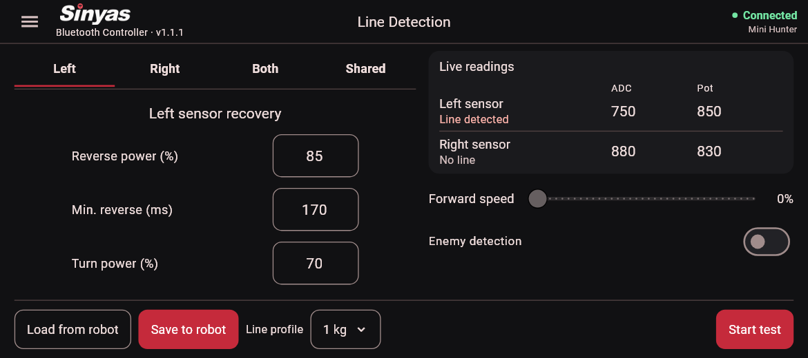
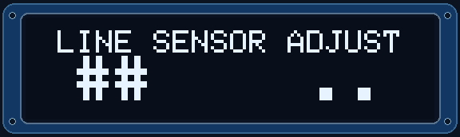

  <h1>Calibrate your Mini Hunter</h1>
  
Check that your robot can tell the white boundary from the dark floor and read distances before you run it.

  <aside class="calibration-safety" aria-label="Before you start">
    <strong>Before you start</strong>
    
Put the robot on a secure stand. Keep the blade and the wheels clear.

  </aside>

  <section aria-labelledby="choose-your-guide">
    <h2 id="choose-your-guide">Choose your firmware guide</h2>
    
Use the version you last uploaded to your robot.

    <nav class="calibration-jump" aria-label="Jump to a firmware version">
      <a href="#new-guide--v28">V2.8 · Sinyas</a>
      <a href="#v27-guides">V2.7 · OLED</a>
    </nav>

    

      <section class="calibration-path calibration-path--sinyas" id="new-guide--v28" aria-labelledby="calibration-v28">
        <h3 id="calibration-v28">V2.8 with Sinyas</h3>
        <figure>
          
          <figcaption>On the robot, look for <a href="../../assets/images/mini-hunter/calibration/mh-cal-v28-sensor-menu.png">Sensor Check</a> in CAL Mode. On the phone, this is <strong>Line Detection</strong>.</figcaption>
        </figure>
        
Check live readings, tune line recovery and steering, and balance the wheels.

        <a class="primary-action" href="sinyas-v2-8.html">Open the Sinyas calibration guide</a>
      </section>

      <section class="calibration-path" id="v27-guides" aria-labelledby="calibration-v27">
        <h3 id="calibration-v27">V2.7 with the OLED</h3>
        <figure>
          
          <figcaption>In CAL MODE, tap <strong>SW1</strong> for Line Sensor Adjust.</figcaption>
        </figure>
        
Use the board’s screen and buttons to check the sensors.

        

          <a href="line-sensors.html">Adjust the line sensors</a>
          <a href="enemy-detection.html">Check the distance sensors</a>
        

      </section>
    

  </section>

  <section class="calibration-reference" aria-labelledby="firmware-help">
    <h2 id="firmware-help">Firmware and menu help</h2>
    
<strong>Using Sinyas?</strong> Update Mini Hunter V2.7 or earlier to Sinyas-compatible V2.8 firmware first.

    

      
Check your version or request an update

      

        
If you’re unsure which firmware you have, check the sketch name from the last upload.

        
To request the latest compatible firmware, email <a href="mailto:twentyninerobotics@gmail.com">twentyninerobotics@gmail.com</a> or message Twentynine Robotics on Facebook. Include your robot’s weight class and firmware version if you know them.

      

    

    

      
Enter CAL MODE on V2.7

      

        <ol>
          <li>Power on the robot while it is on the stand.</li>
          <li>Set the <strong>MODE</strong> switch so the OLED shows <strong>RC/RMT</strong>.</li>
          <li>Hold <strong>SW1 + SW2</strong> for two seconds. Release them when <strong>CAL MODE</strong> appears.</li>
          <li>Tap <strong>SW1</strong> once for <strong>Line Sensor Adjust</strong> or twice for <strong>Enemy Detection Check</strong>.</li>
        </ol>
        
Hold <strong>SW1 + SW2</strong> again to exit calibration. Power off before taking the robot off the stand.

      

    

  </section>

