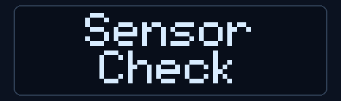
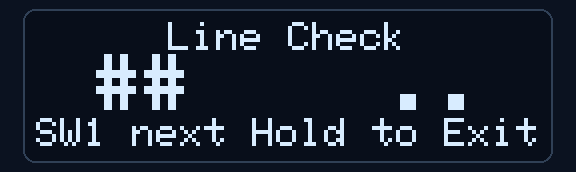
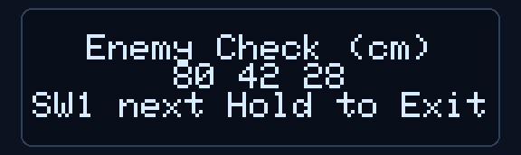
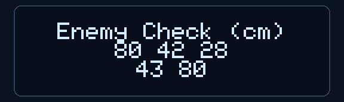
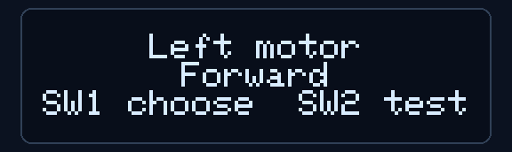
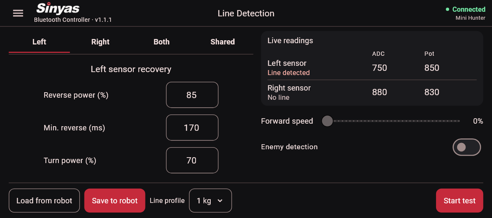
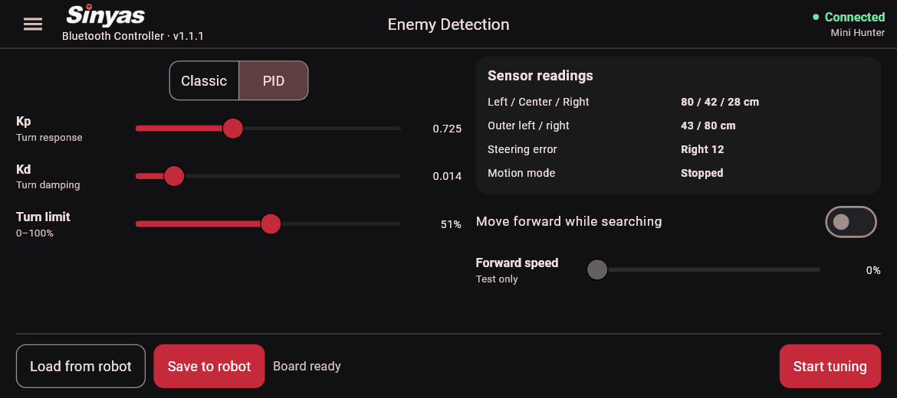
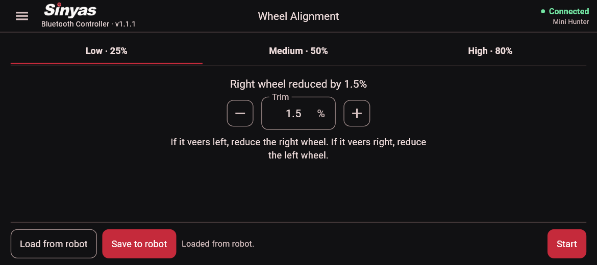

# Calibrate Mini Hunter V2.8 with Sinyas

Use the Mini Hunter’s screen to check the sensors and motors. Connect Sinyas when you want to adjust, test, and save how the robot moves.

<nav class="calibration-route-nav" aria-label="Calibration paths">
  <a href="#sensor-check"><strong>Robot only</strong>Sensor Check and Motor Check</a>
  <a href="#tune-with-sinyas"><strong>With Sinyas</strong>Line recovery, steering, wheel trim, and modes</a>
</nav>

## What you need

<dl class="calibration-kit">
  

    <dt>For robot checks</dt>
    <dd>Mini Hunter with V2.8 firmware, a secure stand, black and white arena samples, and a box for checking distance sensors.</dd>
  

  

    <dt>For Sinyas tuning</dt>
    <dd>An Android phone with <a href="../../sinyas/releases.html#v111">Sinyas V1.1.1</a> and the robot’s Bluetooth module <a href="../../sinyas/mini-hunter.html#3-pair-the-phone-then-connect-in-sinyas">paired in Android settings</a>. Keep a small screwdriver handy if you are adjusting a line sensor threshold.</dd>
  

</dl>

  <strong>Before powering the wheels</strong>
  
Stop Drive and place the robot on a secure stand. Use a clear floor only for driving tests. Keep hands clear of the wheels and flag.

  
Check firmware compatibility

  
  
Using V2.7 without Sinyas? Follow the <a href="./#v27-guides">original OLED calibration guides</a>.

## Open CAL Mode on the robot

  <ol>
    <li>Return to the robot’s <strong>REMOTE</strong> main screen.</li>
    <li>Hold <strong>SW1 + SW2</strong> until the CAL Mode bar fills. Release both buttons when <strong>Sensor Check</strong> appears.</li>
    <li>Tap <strong>SW1</strong> to browse the tools. Tap <strong>SW2</strong> to open the one you need.</li>
  </ol>
  <figure class="guide-figure">
    
    <figcaption><strong>On the robot.</strong> Sensor Check is the first entry in CAL Mode.</figcaption>
  </figure>

**Remember:** Hold **SW2** for two seconds to return from a tool to the CAL menu. From the CAL menu, hold **SW1 + SW2** for two seconds to leave calibration.

<h2 id="sensor-check">Robot-only checks</h2>

Use the OLED and board buttons for these two checks.

### Sensor Check

1. Open **Sensor Check**. The OLED starts on **Line Check**. Hold the floor sample under one sensor at normal driving height, then switch to the white sample. Repeat on the other side.

    <figure class="guide-figure guide-figure--compact step-figure">
      
      <figcaption><strong>Line Check.</strong> The left sensor sees the line (<code>##</code>). The right sensor sees the floor (<code>..</code>).</figcaption>
    </figure>

2. Tap **SW1** to switch to **Enemy Check (cm)**. Bring a box toward each sensor one at a time. The number for that sensor should fall as the box gets closer.

    
<strong>Three sensors.</strong> Read the numbers as front left, front center, and front right.

    <figure class="guide-figure guide-figure--compact step-figure">
      
      <figcaption><strong>Three-sensor example.</strong> The front-right reading is 28 cm.</figcaption>
    </figure>

    
<strong>Five sensors.</strong> The top number row is the same. The two numbers below it are the outer left and outer right sensors.

    <figure class="guide-figure guide-figure--compact step-figure">
      
      <figcaption><strong>Five-sensor example.</strong> The outer-left reading is 43 cm. Your readings will change with the target.</figcaption>
    </figure>

3. Hold **SW2** to return to the CAL menu.

### Motor Check

1. Keep both wheels off the ground and open **Motor Check**.
2. Tap **SW1** to choose a wheel and direction.

    <figure class="guide-figure guide-figure--compact step-figure">
      
      <figcaption><strong>On the robot.</strong> This example selects the left motor in the forward direction.</figcaption>
    </figure>

3. Tap **SW2** to pulse the selected wheel. Check that it turns in the displayed direction. Either button stops the pulse.
4. Hold **SW2** to return to the CAL menu.

## Tune with Sinyas

**Open the calibration tool on the robot before tapping Connect in Sinyas.** The open tool lets the board identify itself as a Mini Hunter.

  <ol>
    <li><strong>On the robot</strong>, pick a task below. In CAL Mode, browse to its tool with <strong>SW1</strong>, then press <strong>SW2</strong> to open it. Leave the tool open.</li>
    <li><strong>In Sinyas</strong>, open <strong>Bluetooth</strong> and tap <strong>Connect</strong> beside your paired robot.</li>
    <li>Wait for <strong>Mini Hunter</strong> to appear under <strong>Connected</strong>. Then open the matching screen in Sinyas.</li>
  </ol>
  <figure class="guide-figure">
    
    <figcaption><strong>In Sinyas.</strong> This robot has serial 0082. On your phone, choose the name with your own robot’s serial number.</figcaption>
  </figure>

**If Sinyas shows Generic:** Disconnect in Sinyas, open the tool on the robot with **SW2**, then reconnect. Wait for the **Mini Hunter** profile before tuning.

  <a href="#line-detection"><strong>Check the white boundary</strong>Line Tune on the robot · Line Detection Tuning in Sinyas</a>
  <a href="#enemy-detection-tuning"><strong>Tune steering toward a target</strong>PID Tune on the robot · Enemy Detection Tuning in Sinyas</a>
  <a href="#wheel-alignment"><strong>Make the robot drive straight</strong>Wheel Alignment on the robot and in Sinyas</a>
  <a href="#opening-moves-and-flag-settings"><strong>Test opening moves or the flag</strong>Modes Tune on the robot · Auto modes in Sinyas</a>

### Line detection

#### Check the sensor thresholds

1. **On the robot**, open **Line Tune** with SW2.

    <figure class="guide-figure guide-figure--compact step-figure">
      
      <figcaption><strong>Line Tune.</strong> Tap SW2 to open it, then open Line Detection Tuning on your phone.</figcaption>
    </figure>

2. **In Sinyas**, open **Line Detection Tuning**. Keep the test stopped and look under **Live readings**. **ADC** is the sensor reading and **Pot** is its threshold.

    <figure class="guide-figure step-figure">
      
      <figcaption><strong>On your phone.</strong> Read ADC and Pot under Live readings. To change recovery settings, pick a Line profile at the bottom. The sensor numbers are examples.</figcaption>
    </figure>

3. Show one sensor the black floor, then the white line. Look for **No line** on black and **Line detected** on white. If needed, adjust the small screw for that side, then check both surfaces again. Repeat on the other side.

    <figure class="guide-figure step-figure">
      
      <figcaption><strong>Left and right adjustments.</strong> Change one potentiometer at a time and watch the matching sensor in Sinyas.</figcaption>
    </figure>

#### Choose and test line recovery settings

1. Tap **Load from robot** to see the settings currently in use. Choose **1 kg** or **3 kg** in **Line profile** if you want to start from that weight preset. Sinyas fills all four tabs. Use one of the three **Custom** slots and its pencil button to keep a named copy of your own settings on the phone.
2. Choose **Left**, **Right**, or **Both** to adjust the corresponding recovery move. **Shared** holds the timings used by all three.
3. Keep **Forward speed** at **0%** for the first test on the stand. Choose **Start test**, show the white sample to each sensor in turn, and check that the wheels are turning in the expected directions. To test motion on the floor, use a clear test area and raise the forward speed gradually. Leave **Enemy detection** off while you isolate the line response.
4. Tap **Stop test**, then **Save to robot** to apply the displayed settings. **Load from robot** can confirm the values after a restart.

### Enemy detection tuning

1. **On the robot**, open **PID Tune**. Once opened, the OLED shows **Enemy Tune** for Classic or **PID Tune** for PID.
2. **In Sinyas**, open **Enemy Detection Tuning** and check that the sensor readings change as you move a target.

    <figure class="guide-figure step-figure">
      
      <figcaption><strong>On your phone.</strong> Choose Classic or PID at the top, then check the sensor readings before starting.</figcaption>
    </figure>

3. Choose **Classic** for set turn powers or **PID Beta** for a turn that changes as the target moves. Start at **0%** forward power to check turning in place.
4. Follow the [Classic and PID Beta walkthrough](../../sinyas/enemy-tuning.html) to compare them. Stop the test before tapping **Save to robot**.

### Wheel alignment

1. **On the robot**, open **Wheel Alignment**, just after **Motor Check**. An earlier V2.8 build that includes wheel trim may put it under **Modes Tune**.

    <figure class="guide-figure guide-figure--compact step-figure">
      
      <figcaption><strong>Wheel Alignment.</strong> Tap SW2 and then open Wheel Alignment in Sinyas.</figcaption>
    </figure>

2. **In Sinyas**, open **Wheel Alignment** and tap **Load from robot**. On a clear, flat surface, select **Low · 25%** and tap **Start**. Watch which way the robot drifts, then tap **Stop**.

    <figure class="guide-figure step-figure">
      
      <figcaption><strong>On your phone.</strong> Start with Low · 25%. Use − and + to adjust trim between runs, then use Save to robot when it drives straight.</figcaption>
    </figure>

3. If it drifts left, use **+** to slow the right wheel. If it drifts right, use **−** to slow the left wheel. Each tap changes the value by **0.5 points**. Repeat at **50%** and **80%** when you have enough room.
4. Tap **Stop**, then **Save to robot**. The saved trim applies during forward driving in RC and Auto. During a wheel test, the board also stops if it detects a line or loses the phone's control signal.

### Opening moves and flag settings

Open **Modes Tune** on the robot and **Auto modes** in Sinyas. The Sinyas guide covers how to [test an opening or base mode](../../sinyas/mini-hunter.html#8-build-and-test-your-first-opening) and [check the flag servo](../../sinyas/mini-hunter.html#9-test-the-flag-without-driving).

<figure class="guide-figure guide-figure--compact step-figure">
  
  <figcaption><strong>On the robot.</strong> Leave Modes Tune open while using the Opening, Base modes, or Flag servo tab in Sinyas.</figcaption>
</figure>

## If the app cannot save

| What you see | What to check |
| --- | --- |
| **Save to robot** is gray in Wheel Alignment | Open the matching board menu, stop the test, then tap **Load from robot**. Wait for **Loaded from robot** before saving. |
| **Board storage unavailable** | If you compiled V2.8 yourself in Arduino IDE, choose **Tools → Optimize → Smallest (-Os) with LTO (advanced)** and upload again. This leaves space for the calibration settings. |
| Sinyas shows **Generic** or the tuning screens are missing | Disconnect in Sinyas. Open the desired calibration tool on the robot first, then reconnect. If the profile still shows **Generic**, check that the board is running compatible V2.8 firmware. |
