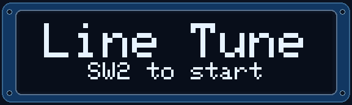
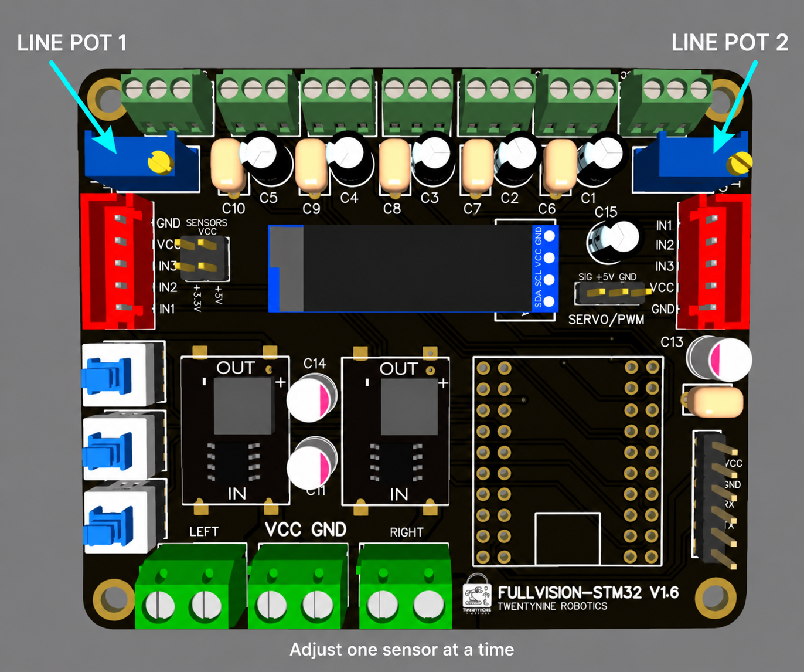

# Calibrate Mini Hunter V2.8 with Sinyas

This guide is for **MiniHunterV2.8_Advance** and **Sinyas V1.1.1**. For a robot running V2.7, use the [original OLED calibration guides](./#v27-guides).



## What you need

- A Mini Hunter with its OLED and Bluetooth module connected
- An Android phone with [Sinyas installed](../../sinyas/releases.html#v111) and the module [paired in Android settings](../../sinyas/mini-hunter.html#3-pair-the-phone-then-connect-in-sinyas)
- A sample of the black floor and white boundary, a small screwdriver for the line sensor adjustments, and a box to use as a distance target
- A secure stand that keeps the wheels clear for sensor checks

> **Safety:** Stop Drive and support the robot before checking its sensors. Move to a clear test surface before starting a driving test. Keep hands away from the wheels and flag while the test is active.

## 1. Open the calibration menu

1. Return to the robot's **REMOTE** main screen. Hold **SW1 and SW2** together until the **CAL Mode** bar fills, then release them.
2. The first menu entry is **Sensor Check**.

    <figure class="guide-figure guide-figure--compact step-figure">
      
      <figcaption><strong>Sensor Check.</strong> This is the first entry in the V2.8 calibration menu.</figcaption>
    </figure>

3. Tap **SW1** to browse. Tap **SW2** to open the entry shown. Hold **SW2** for two seconds to return to that entry. Hold **SW1 + SW2** for two seconds from the CAL menu to leave calibration.
4. For phone tuning, open **Bluetooth** in Sinyas and connect to your paired module. Wait for **Mini Hunter** to appear before opening the matching screen.

| What you want to do | OLED menu entry | Sinyas screen |
| --- | --- | --- |
| Check sensors while the robot stays still | **Sensor Check** | Use the OLED |
| Test one motor while the robot is on the stand | **Motor Check** | Use the OLED |
| Make the robot drive straight | **Wheel Alignment** | **Wheel Alignment** |
| Adjust how it turns toward a target | **PID Tune** | **Enemy Detection Tuning** |
| Adjust how it moves away from the white line | **Line Tune** | **Line Detection Tuning** |
| Test or save openings, base modes, or flag settings | **Modes Tune** | **Auto modes** |

## Sensor check

1. Open **Sensor Check**. On **Line Check**, put the floor sample under one sensor, then replace it with the white sample at normal driving height. Repeat on the other side. **`..`** means no line and **`##`** means a line.
2. Tap **SW1** to switch to **Enemy Check**. Bring a box toward each sensor in turn. The distance for that direction should fall as the box comes closer. On a five-sensor robot, check the far left and far right as well as the three front sensors.
3. Hold **SW2** to return to the CAL menu.

## Line detection

### Check the sensor thresholds

1. Open **Line Tune** on the board and **Line Detection Tuning** in Sinyas. Keep the test stopped.

    <figure class="guide-figure guide-figure--compact step-figure">
      
      <figcaption><strong>Line Tune.</strong> Tap SW2 to open it, then open Line Detection Tuning on your phone.</figcaption>
    </figure>

2. Watch **Live readings**. **ADC** is the sensor reading and **Pot** is its threshold. Show one sensor the black floor and then the white line. The white line should show **Line detected**. If it does not, adjust the small screw for that side, then test both surfaces again. Repeat on the other side.

    <figure class="guide-figure">
      
      <figcaption><strong>Left and right adjustments.</strong> Change one potentiometer at a time and watch the matching sensor in Sinyas.</figcaption>
    </figure>

### Choose and test line recovery settings

1. Tap **Load from robot** to see the settings currently in use. Choose **1 kg** or **3 kg** in **Line profile** if you want to start from that weight preset. Sinyas fills all four tabs. Use one of the three **Custom** slots and its pencil button to keep a named copy of your own settings on the phone.
2. Choose **Left**, **Right**, or **Both** to adjust the corresponding recovery move. **Shared** holds the timings used by all three.
3. Keep **Forward speed** at **0%** for the first test on the stand. Choose **Start test**, show the white sample to each sensor in turn, and check that the wheels are turning in the expected directions. To test motion on the floor, use a clear test area and raise the forward speed gradually. Leave **Enemy detection** off while you isolate the line response.
4. Tap **Stop test**, then **Save to robot** to apply the displayed settings. **Load from robot** can confirm the values after a restart.

## Enemy detection tuning

1. Open **PID Tune** from the V2.8 CAL menu. Open **Enemy Detection Tuning** in Sinyas. The calibration menu entry says **PID Tune**. Once opened, the OLED shows **Enemy Tune** for Classic or **PID Tune** for PID.
2. Two options are available. **Classic** turns toward a sensor hit using set turn powers. **PID Beta** adjusts the turn based on how far the target is from the center. Start with forward power at **0%** to check how it turns in place.
3. Follow the [Classic and PID Beta walkthrough](../../sinyas/enemy-tuning.html) to tune and compare them. After testing, stop the run and tap **Save to robot** to keep the settings.

## Wheel alignment

1. On the board, **Wheel Alignment** is just after **Motor Check**. Open it with **SW2**. An earlier V2.8 build that includes wheel trim may put it under **Modes Tune**.

    <figure class="guide-figure guide-figure--compact step-figure">
      
      <figcaption><strong>Wheel Alignment.</strong> Tap SW2 and then open Wheel Alignment in Sinyas.</figcaption>
    </figure>

2. In Sinyas, tap **Load from robot**. On a clear, flat surface, select **Low · 25%**, tap **Start**, and watch the robot drive. Tap **Stop** before making your adjustment.
3. If it drifts left, use **+** to slow the right wheel. If it drifts right, use **−** to slow the left wheel. Each tap changes the value by **0.5 points**. Repeat at **50%** and **80%** when you have enough room.
4. Tap **Stop**, then **Save to robot**. The saved trim applies during forward driving in RC and Auto. During a wheel test, the board also stops if it detects a line or loses the phone's control signal.

## Opening moves and flag settings

Open **Modes Tune** on the robot and **Auto modes** in Sinyas. The Sinyas guide covers how to [test an opening or base mode](../../sinyas/mini-hunter.html#8-build-and-test-your-first-opening) and [check the flag servo](../../sinyas/mini-hunter.html#9-test-the-flag-without-driving).

## If the app cannot save

| What you see | What to check |
| --- | --- |
| **Save to robot** is gray in Wheel Alignment | Open the matching board menu, stop the test, then tap **Load from robot**. Wait for **Loaded from robot** before saving. |
| **Board storage unavailable** | If you compiled V2.8 yourself in Arduino IDE, choose **Tools → Optimize → Smallest (-Os) with LTO (advanced)** and upload again. This leaves space for the calibration settings. |
| The calibration screens are missing from Sinyas | Check that the phone shows **Mini Hunter** and the board is running compatible V2.8 firmware. |
