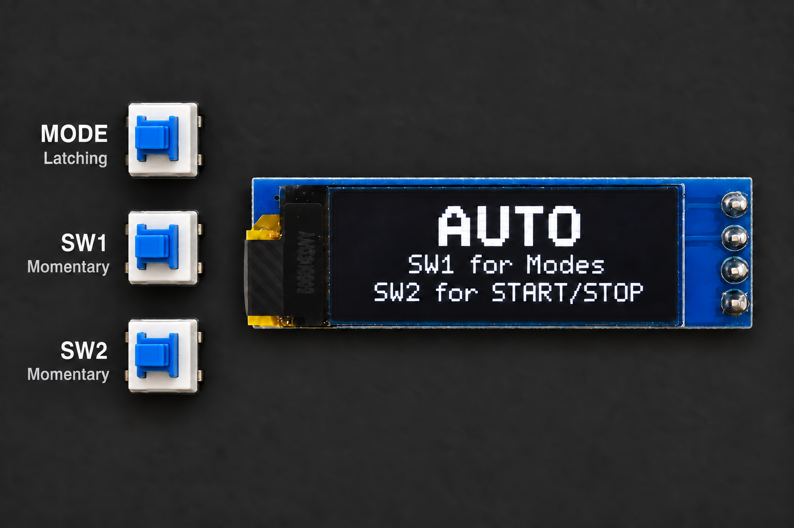
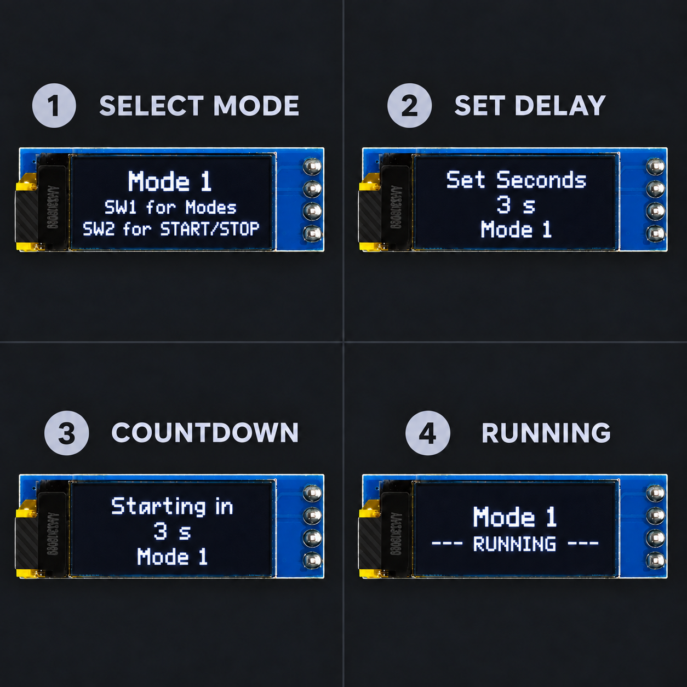
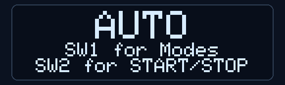
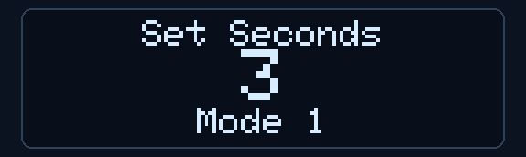
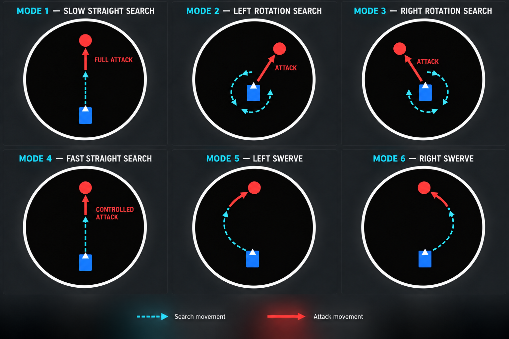

# Modes introduction

A **control mode** decides where movement commands come from. An **autonomous mode number** selects one programmed behavior. These are related, but they are not the same thing.

## Know the three menu controls

<figure class="guide-figure">
  
  <figcaption><strong>MH-MODES-01.</strong> Menu-control reference based on the supplied firmware and board artwork. The three blue rectangular switches are arranged vertically at the board's lower-left; they are not generic tactile switches. The OLED is installed with its soldered pins on the right.</figcaption>
</figure>

| Control | Switch behavior | What it does in the menu |
| --- | --- | --- |
| **MODE** | Latching | Chooses the AUTO menu family or the RC/RMT menu family. It stays in its selected position. |
| **SW1** | Momentary | Moves through the choices shown for the selected menu family. |
| **SW2** | Momentary | Confirms and starts the selected choice when the firmware allows it. |

The screen wording is generated by the code. The current library sets `display.setRotation(2)`, which keeps the text upright while the module's soldered pins are physically on the right.

## Control choices shown by the robot

| Display choice | Meaning | Use it when |
| --- | --- | --- |
| `AUTO` / numbered mode | Autonomous behavior | The robot should use its sensors and selected program without continuous driving input. |
| `BT MODE` | Bluetooth control | A compatible Android panel will send commands. |
| `RC MODE` | RC receiver control | A verified transmitter and receiver will send channel pulses. |
| `JS MODE` | Joystick mode label | A reserved label in V2.7. The standard selector offers Bluetooth and RC. |

After reset, the latching MODE switch determines which menu is shown. **AUTO** is on one side. The controller side reads **RC/RMT** on V2.7 or **REMOTE** on V2.8. Read the OLED before choosing a mode.

On the standard V2.7 build, SW1 cycles through Bluetooth and RC. The reserved `JS MODE` label requires separate joystick hardware and firmware support.

## What the AUTO sequence looks like

<figure class="guide-figure">
  
  <figcaption><strong>V2.7 AUTO sequence.</strong> Select a mode, set its delay, watch the countdown, then check the running screen. The three-second delay is an example.</figcaption>
</figure>

1. Set the latching **MODE** switch to the position that shows `AUTO` on the OLED. Use SW1 to choose a mode number.

    <figure class="guide-figure guide-figure--compact step-figure">
      
      <figcaption><strong>V2.8 AUTO menu.</strong> The OLED tells you which button browses modes.</figcaption>
    </figure>

2. Press **SW1** repeatedly to cycle through the available numbered modes. Stop when the mode you want is displayed.
3. Press **SW2** once to select that mode. The OLED changes to `Set Seconds`.
4. Press **SW1** repeatedly to choose a start delay from 0 through 5 seconds.

    <figure class="guide-figure guide-figure--compact step-figure">
      
      <figcaption><strong>V2.8 delay screen.</strong> This example sets three seconds for Mode 1.</figcaption>
    </figure>

5. Press **SW2** again to confirm the delay. Keep your hands clear while the OLED counts down; the selected mode starts when the countdown finishes.

    <figure class="guide-figure guide-figure--compact step-figure">
      
      <figcaption><strong>V2.8 running screen.</strong> The display names the active mode.</figcaption>
    </figure>

If you pass the value you want, keep pressing **SW1** until the choices cycle back around. Read the OLED after every press instead of pressing both momentary switches together.

## Default autonomous modes

The paths below are simplified top-down examples. The blue box is Mini Hunter, the white triangle is its front, and the red circle is the opponent. Cyan dashed arrows show the search movement; red arrows show the attack after the front sensors find the opponent.

<figure class="guide-figure">
  
  <figcaption><strong>MH-MODES-03.</strong> Simplified default paths for Modes 1–6. Boundary detection and enemy-sensor reactions can interrupt the illustrated search path.</figcaption>
</figure>

| Mode | What it does while no opponent is detected | When the front sensors detect an opponent |
| --- | --- | --- |
| **1 — Slow straight search** | Drives straight at 20% search power. | Approaches at 60% when the target is farther away, then uses the configured `attackSpeed` at close range. |
| **2 — Left rotation search** | Rotates left at 35% search power. | Approaches at 60%, then uses `attackSpeed - 15` at close range. |
| **3 — Right rotation search** | Rotates right at 35% search power. | Approaches at 60%, then uses `attackSpeed - 15` at close range. |
| **4 — Fast straight search** | Drives straight at 30% search power. | Approaches at 60%, then uses `attackSpeed - 15` at close range. |
| **5 — Left swerve** | Starts with a short left rotation and curved approach, then changes to Mode 1 search. | The normal front-sensor attack response takes priority whenever an opponent is detected. |
| **6 — Right swerve** | Mirrors Mode 5 to the right, then changes to Mode 1 search. | The normal front-sensor attack response takes priority whenever an opponent is detected. |

For the supplied 1 kg values, `attackSpeed` is 100, so `attackSpeed - 15` is 85. The middle-distance 60% approach applies to every mode before the close-range attack.

> **Firmware accuracy note:** The current shared code does not make Modes 2 and 3 attack at the full configured speed, and Mode 4 is not capped below 80%; Modes 2–6 all use `attackSpeed - 15` for the close-range front attack. The guide describes the code as it works now. Those descriptions should be changed only after the firmware behavior is deliberately updated and tested.

## Systems versus modes

- A **3-system** robot uses front-left, front, and front-right enemy sensors.
- A **5-system** robot adds left and right enemy sensors.
- A **4-mode** program contains four selectable autonomous behaviors.
- A **7-mode** program contains seven selectable autonomous behaviors.
- **1 kg** and **3 kg** describe hardware/competition configurations; they do not automatically prove which sensor or mode count is loaded.

Check both the physical robot and the program configuration before uploading.

## Safe first run

1. Confirm the intended firmware and control mode.
2. Check battery security, attachments, and blade clearance.
3. Test sensor readings in calibration mode.
4. Perform the first movement test on a stand or in a controlled test area.
5. Keep a direct way to remove power.
