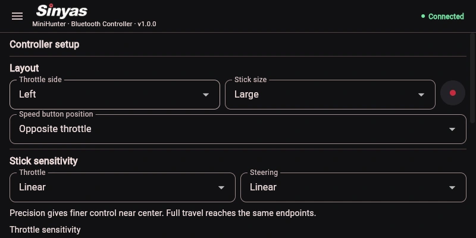

# Find a control in Sinyas

Open the **☰** menu beside the Sinyas logo. Stop Drive or the current test before changing screens. Use the [first-time setup guide](./) if you have just installed the app.

## Choose a screen

| Phone menu | Use it to |
| --- | --- |
| **Drive** | Start or stop driving, use both sticks, change the speed limit, and send accessory buttons. |
| **Bluetooth** | Open Android Bluetooth settings, view paired devices, connect or disconnect, and check whether the robot answers. |
| **Setup** | Change handedness, stick size, stick response, speed presets, button labels, and theme. |
| **Auto modes** | Edit and rehearse openings, set draft base speeds, or test the flag servo on a compatible Mini Hunter. |
| **Enemy Detection Tuning** | Compare Classic and PID Beta target tracking on a compatible Mini Hunter. |
| **Line Detection Tuning** | See readings and tune what the Mini Hunter does when it touches the boundary. |
| **Guide** | Read the quick connection and message-format notes inside the app. |
| **Configuration** | Export or import phone settings and presets as a JSON file. |
| **About** | Check the app version, replay the boot screen, and open **Diagnostics**. |
| **Exit** | Close Sinyas and its Bluetooth connection after you confirm. |

Drive, Bluetooth, Setup, Guide, Configuration, and About are available for general use. Mini Hunter pages appear after the board identifies itself. Some controls also need a matching tool open on the board. Hammerhead and Generic projects use Drive. Follow the [Hammerhead guide](hammerhead.html) or [Arduino guide](generic.html) for the board side.

## Bluetooth and the robot name

| What you see | What it tells you |
| --- | --- |
| **Paired device** | Android remembers this HC-05. Choose **Connect** in Sinyas to open the link. |
| **Connected** | The phone reached the Bluetooth module. |
| **Robot replies · Receiving** | The board answered. If this says **No recent reply**, check the robot’s mode, serial wiring, and data speed. |
| **Identifying robot…** | Sinyas is waiting for the board to announce which robot it is. |
| **MiniHunter**, **Hammerhead**, or **Generic** | On Bluetooth and Drive, the profile appears under the Sinyas logo. Generic can be correct for your own project, even when it sends the normal Drive replies. |

If the module is missing, use **Open Android settings** to turn Bluetooth on and pair it, then return to Sinyas and use the refresh icon. If Sinyas asks for **Nearby devices**, allow it so the app can open a Bluetooth connection. Sinyas can try the last connected device again on launch. Check the device before starting, especially if two HC-05 modules have the same name.

## Drive and the numbers on screen

1. With the robot ready, wait for **Start** to become available.
2. Tap **Start** and wait for the robot to confirm. **Waiting for Start ACK** means the phone is waiting for that confirmation.
3. Move the throttle stick forward or backward and the steering stick left or right. You can use both thumbs at once. Each stick returns to center when released.
4. Pick **1**, **2**, or **3** to change the speed limit. The percentage below the button is the limit you set in Setup.
5. Tap **A**, **B**, or **C** to switch an accessory signal on. Tap it again to switch it off. The robot’s program decides what each signal does.
6. Hold **Stop** until the bar fills at **2000 ms**, which is two seconds. The app sends a stop when you first touch the button. Releasing early can request a fresh run, so finish the hold when you want to end driving.

| Display | What it means |
| --- | --- |
| **Throttle** and **Steering** | Each stick sends 1000–2000, with **1500** at center. Forward is below 1500. Right is above 1500. |
| **Outgoing** | The message sent by the phone while driving. **Drive off** means Drive is stopped. |
| **Robot reply** | The link or Start status, or the latest reading sent by the board, such as battery voltage. |
| **Robot link timed out** | The board stopped replying. Sinyas ends the run. Check the board and wait for a fresh reply before pressing Start. |

<strong>Stop on Mini Hunter.</strong> A completed hold also asks a compatible Mini Hunter in BT Mode to exit to its board menu. A Generic or Hammerhead project clears its outputs according to its program. Start again only after checking the board.

Leaving Sinyas during Drive or a test stops that session. Return to the app and press Start again when the board is ready.

## Setup and personalize your controls

Open **Setup** while Drive is stopped. Changes save to the phone as you make them.

<figure class="guide-figure">
  
  <figcaption>Scroll down the Setup page to find stick response, speed presets, button labels, and theme. Screenshot from the Sinyas simulator.</figcaption>
</figure>

| Setting | How to use it |
| --- | --- |
| **Throttle side** | Put forward and reverse on the left or right. Steering uses the other side. |
| **Stick size** | Choose Medium, Large, or XL. Try a larger pad if you need more room for thumb movement. |
| **Speed button position** | Choose **Opposite throttle** to move the speed controls with your layout, or use **Fixed left** or **Fixed right**. |
| **Throttle** and **Steering** curves | **Linear** spreads the response evenly. **Precision** gives finer movement near center. **Quick** gives more response with a small movement. |
| **Throttle sensitivity** and **Steering sensitivity** | Set each from **50% to 150%**. Start at 100%. Move one slider a little and compare the same thumb movement on Drive. |
| **Speed presets** | Edit buttons 1, 2, and 3 separately. The default limits are **40%, 70%, and 100%**. For a first test, lower the preset your class will use. |
| **Programmable buttons** | Give A, B, and C short names of up to eight characters. Renaming a button changes its label. Its signal keeps the same number. |
| **Theme** | Choose Dark or Light, then a red, blue, green, purple, or amber highlight. |

**Example.** For gentler turns, leave the throttle settings as they are and choose **Precision** under **Steering**. Return to Drive and compare small steering movements at a low speed limit.

## Mini Hunter tools and what gets saved

| Screen | What you can test | How to keep it |
| --- | --- | --- |
| **Auto modes → Opening** | Arrange steps, run without a base mode, or include the base after the opening. | **Save to robot** writes slots 5–10 on compatible firmware with the corrected V1.0 APK. **Save preset** keeps a separate phone copy. |
| **Auto modes → Base modes** | Change how quickly the draft’s selected base moves when there is no target. | **Save preset** keeps the draft base speeds on the phone. |
| **Auto modes → Flag servo** | Check open and closed angles without moving the wheels. | **Save preset** keeps the test angles on the phone. |
| **Line Detection Tuning** | Read each sensor, check its threshold, and try recovery moves. | **Save to robot** writes supported recovery settings. **Phone presets** saves copies on this phone. The physical pots are adjusted on the robot. |
| **Enemy Detection Tuning** | Compare Classic and PID Beta while pivoting or approaching a target. | **Save to robot** writes the tracker choice and Classic settings on compatible boards. PID gains and the live forward and search controls are for testing. |

Use the [Mini Hunter lessons](mini-hunter.html) for Auto, line, and flag tests. Use the [enemy tuning lesson](enemy-tuning.html) for step-by-step Classic and PID Beta tests.

## Back up your settings

1. Open **Configuration**. Tap **Export configuration**.
2. Choose a location in Android’s file picker. Keep the JSON file where you can find it later.
3. To restore or copy settings to another phone, open **Configuration → Import configuration** and select the file.
4. Read the confirmation. Import replaces the app settings and phone presets with those in the file. Export your current settings first if you may need them again.

A JSON file is a text file with settings in a form the app can read. The backup includes the phone’s controller layout, sensitivity, speed presets, button names, theme, and saved line and Auto presets. To copy line settings from a robot, first **Load from robot**, then save them as a **Phone preset** before exporting. A phone import does not write settings to the robot.

## Read the in-app Guide or check a problem

Open **Guide** to see how the stick numbers, accessory buttons, command messages, and robot replies fit together. If you are programming a new board, follow the [Arduino lesson](generic.html) to make an LED work before attaching any motors.

Under **About**, find the app version, replay the boot screen, or open **Diagnostics**. Diagnostics can help you report connection, timeout, and serial-write issues.

1. Reproduce the issue on the stand, then stop the robot.
2. Open **About → Diagnostics** and choose **Copy logs**.
3. When asking for help, include the app version, robot or board model, what screen you used, and which step failed. Send the logs only if you choose to share them.
4. Use **Clear logs** after you have saved any entries you still need.

Serial timing in Diagnostics measures when Android writes data. It does not measure when the robot receives a command or moves its motors.

[Back to Sinyas setup](./)
