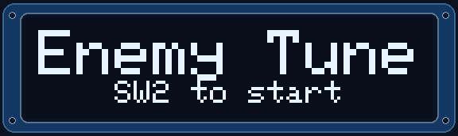
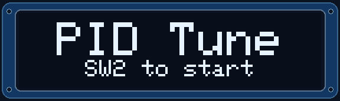
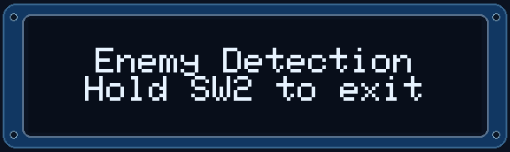
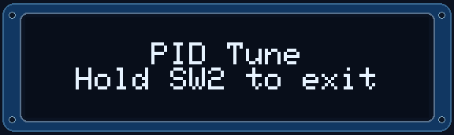
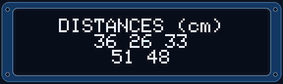
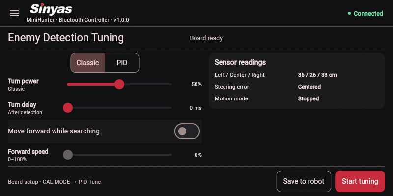
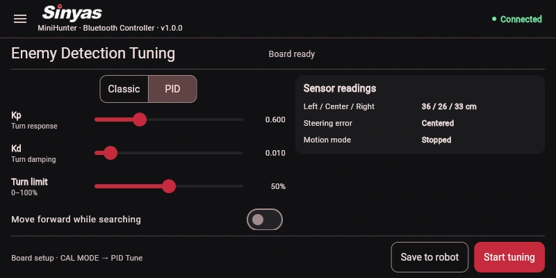

# Tune enemy detection

Enemy Detection Tuning lets you see where Mini Hunter sees a target and practice how it turns. Both choices use the same distance sensors. You choose how the robot reacts.

<strong>PID is in beta.</strong> The app tab is labeled <strong>PID</strong>. Check it on your robot before choosing it for a match. You can switch back to Classic at any time.

## Choose Classic or PID Beta

| Choose | What the robot does | Why you might prefer it |
| --- | --- | --- |
| **Classic** | If only a side sees the target, the robot waits for your turn delay and then pivots at the fixed turn power you set. If the front center sees it, forward movement is allowed. | You want predictable settings and an easy starting point for students. |
| **PID Beta** | The robot changes steering power as the target moves across the sensors. It can turn harder when the target is far from the center and ease off as it lines up. | You want to experiment with smoother centering and can spend time testing on your own wheels and surface. |

There is no single best choice for every robot. Try both with the same target, distance, and battery. Choose the one that repeatedly turns toward the target and settles the way you want. Classic is the default in the matching firmware.

## 1 Open the tuning screen

1. Put the Mini Hunter on a secure stand with the wheels clear. Stop any Drive session.
2. On the board, hold **SW1 and SW2 together** until **CAL MODE** appears. Release both.
3. Tap **SW1** until you see the tool name for your saved setting.

    **If you saved Classic**, look for **Enemy Detection**.

    <figure class="guide-figure guide-figure--compact step-figure">
      
      <figcaption>Enemy Detection is selected.</figcaption>
    </figure>

    **If you saved PID**, look for **PID Tune**.

    <figure class="guide-figure guide-figure--compact step-figure">
      
      <figcaption>PID Tune is selected.</figcaption>
    </figure>

4. Tap **SW2** once to open the tool.

    **When Classic is saved**, the board shows Enemy Detection with the exit instruction.

    <figure class="guide-figure guide-figure--compact step-figure">
      
      <figcaption>The Classic tool is open.</figcaption>
    </figure>

    **When PID is saved**, the board shows PID Tune with the same exit instruction.

    <figure class="guide-figure guide-figure--compact step-figure">
      
      <figcaption>The PID tool is open.</figcaption>
    </figure>

5. On the connected phone, tap **☰ → Enemy Detection Tuning**. Wait for **Board ready** and numbers under **Sensor readings**.
6. Choose **Classic** or **PID** in the app while stopped. When the board supports both, changing the tab selects what the next test will use.

The OLED follows the saved setting. You can try the other method in Sinyas first. The OLED name changes after the robot confirms **Save to robot**.

**Check.** If the app keeps showing a waiting message, confirm the board is inside the tool and the header says **MiniHunter**. If only PID controls appear, the board has not reported its Classic settings. Check the matching firmware before trying to save.

## 2 Read the sensors before moving

1. Leave the test stopped. Hold a target in front from a safe position. A piece of stiff cardboard is enough for a first test.
2. Show the target to the left, center, and right one at a time. Watch the corresponding distance in centimeters. A five-sensor board can also show **Outer left / right**.
3. Watch **Steering error**. **Left** or **Right** shows the direction the robot thinks it needs to turn. **Centered** means the app received a zero steering error. A dash can mean no target was found or the board has not reported a reading.
4. Use a ruler to repeat the test at the same distance. Start within the robot’s range. The V2.8 baseline uses a **50 cm** scan setting, but your firmware and real sensor readings may differ.

**Check.** The readings follow the target before you test any motor settings. If they do not, check the individual sensors from the board’s distance screen first.

**Optional OLED check.** From CAL MODE, tap SW1 twice. Read the three front sensors left to right. A five-sensor build shows the two outer sensors on the next row.

<figure class="guide-figure guide-figure--compact step-figure">
  
  <figcaption>These distances are examples. The numbers change with the target.</figcaption>
</figure>

## 3 Tune Classic

| Control | What to watch |
| --- | --- |
| **Turn power** | The same percent is used each time a side detection calls for a pivot. Raise it a little if the wheels fail to turn. Lower it if the robot swings past the target. |
| **Turn delay** | The pause before a side pivot starts. Start at **0 ms** to see the immediate reaction. If quick side readings cause unwanted turns, try a short pause. **100 ms** is one tenth of a second. |
| **Forward speed** | The amount of forward power allowed when the center sees the target during the test. Keep it at **0%** for a pivot-only lesson. |

1. Select **Classic**. Note the current turn power and delay so you can restore them.

    <figure class="guide-figure guide-figure--compact step-figure">
      
      <figcaption>Classic shows Turn power and Turn delay. The simulator supplies the example readings.</figcaption>
    </figure>

2. Tap **Start tuning**. Keep **Forward speed** at **0%** and leave **Move forward while searching** off.
3. Put the target on one side, then the other. Change **Turn power** one small step at a time. Repeat each test at the same distance.
4. If needed, change **Turn delay** and repeat. If the robot waits too long to turn, shorten the delay.
5. Tap **Stop tuning**. If you want Classic for normal Auto, keep **Classic** selected and follow the save steps below.

**Check.** Side detections turn the robot the correct way. A target seen straight ahead with **0%** forward produces no forward movement.

## 4 Tune PID Beta

| Control | What it does | What to try |
| --- | --- | --- |
| **Kp** | Sets how strongly the robot reacts when the target is off-center. | Raise it slightly if turning toward the target is too slow. Lower it if the robot repeatedly swings past the target. |
| **Kd** | Changes how the robot reacts to fast changes in steering error. It can help the robot settle. | After Kp feels close, try a small change if the robot keeps passing the center. Back it down if the response becomes jerky or gets worse. |
| **Turn limit** | Caps how much steering power PID can use. It is a percentage. | Reduce it if turns are too aggressive. If increases to Kp make little difference, the output may already be at the limit. |
| **Forward speed** | Allows the robot to approach when the front center sees the target during the test. | Start at 0%. The app enables this slider after the board confirms Start. |

The app exposes Kp and Kd. It does not have a Ki slider. The matching firmware’s integral gain is set to zero by default.

1. Switch to **PID** and note the numbers on screen. Sinyas starts at **Kp 0.600**, **Kd 0.010**, and **Turn limit 50%** in a fresh session.

    <figure class="guide-figure guide-figure--compact step-figure">
      
      <figcaption>PID shows Kp, Kd, and Turn limit. Scroll down for Forward speed on shorter phones. The simulator supplies the example readings.</figcaption>
    </figure>

2. Tap **Start tuning**. Keep forward at **0%** and move the target from left to center, then right to center.
3. Change **Kp** a little. Repeat the same target movement. Keep the change only if the robot responds more consistently.
4. Adjust **Kd** only after you have a Kp you can repeat. Agree with your teacher on a turn limit that suits your surface and reaction speed.
5. Tap **Stop tuning** when you finish. Write down the values you liked before closing the app.

**What happens near the target?** In the V2.8 baseline, PID uses a lower steering cap near the target. With a 50% far cap and the default 60% near ratio, the cap is 30% at or below 25 cm. The robot can still steer there. Normal Auto can use its configured full forward power when a close target is centered. This tuning screen does not run that Auto rule. The app does not change the 50 cm scan or 25 cm close-distance settings.

## 5 Try forward motion only after the pivot test

1. With your teacher, move to a clear test area and start a new test. Every new test starts at **0%** forward.
2. Increase **Forward speed** a little after the board confirms Start. Show the target to the center sensor and observe the approach.
3. Remove the target. With **Move forward while searching** off, the robot stops when it loses the target. If the switch is available and you turn it on, the robot can move forward at the chosen setting while searching. At **0%**, the switch adds no forward movement.
4. Stop the test before changing tools. A line hit or loss of commands can also stop it. Hold **SW2 for 2 seconds** to exit the board tool.

**Check.** You can predict when the robot will pivot, move forward, and stop. The search switch applies to the tuning test. Normal Auto follows the robot’s selected base or competition mode when it has no target.

## 6 Save and check the result

| Setting | Where it stays |
| --- | --- |
| Classic or PID choice, Classic turn power, and Classic delay | **Save to robot** writes these on compatible boards with calibration storage. They can survive a restart. |
| PID Kp, Kd, and turn limit from the app | Temporary test values. The normal Auto gains and turn cap come from **MiniHunterAutoTuning.h** in the firmware. |
| Forward speed and search switch | Test controls. They do not change the robot’s normal Auto behavior. |

1. Tap **Stop tuning** and wait for the robot to stop.
2. Choose the method you want the robot to keep. Tap **Save to robot** and wait for **Saved to robot**.
3. Check the OLED. It shows **PID Tune** for saved PID or **Enemy Detection** for Classic when the matching firmware confirms the change.
4. To double-check, exit the tool, restart the board, and return to it. The app reads the saved choice and Classic values when it connects to the tool.

If **Save to robot** is gray, stop the test and wait for the board to be ready. If it stays gray, check that the board reports support for saving. Ask your teacher to record any PID gain changes you want to keep and apply them in the firmware.

## When the test stops or reacts strangely

| You see | Try this |
| --- | --- |
| **Line detected** | Stop and move the robot away from the boundary. If the floor is clear, check the line readings and pot thresholds in [Line Detection Tuning](mini-hunter.html#6-check-the-line-sensors-before-changing-movement). Start a new test once both sides show Clear. |
| **Board received no tuning commands** | Check the HC-05 connection, keep Sinyas in the foreground, and confirm the OLED is still inside the tuning tool. Start again from 0% forward. |
| **Waiting for target** | Put the target closer and try each sensor separately. Confirm the displayed distances before raising a gain. |
| The number changes but the wheels stay still | Check that the board confirmed Start and the error actually points left or right. Classic may be waiting for its delay. PID may be centered or limited by Turn limit. |
| The robot turns past the target | In Classic, lower Turn power. In PID Beta, try a lower Kp or Turn limit first. Repeat the same test before changing Kd. |

[Back to the Mini Hunter lessons](mini-hunter.html) · [See all controller screens](controller-reference.html)
