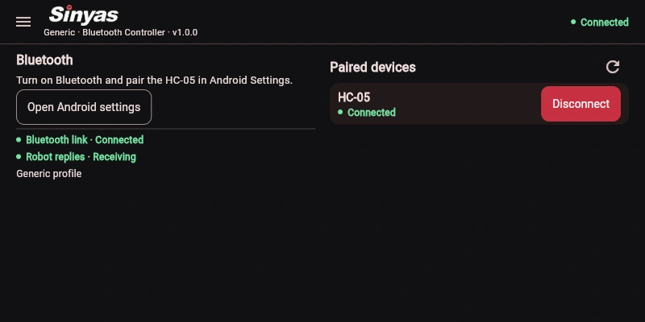

# Generic UART guide

Use Generic for classroom builds and robots with a compatible Bluetooth Classic serial link. This chapter uses an **HC-05** with an Arduino-compatible board. Use Sinyas V1.0 on Android and follow the [pairing guide](./#2-pair-the-hc-05-and-connect) first.

## 1 Wire a bench receiver

Power off the board while wiring. The module data pins connect to the board’s UART. Cross **TX → RX** and **RX ← TX**, and share **GND**. Verify the allowable supply voltage and UART logic levels for your specific HC-05 carrier. Use a suitable level shifter if a 5 V microcontroller’s TX would exceed the module’s RX rating.

| HC-05 | FullVision-STM32 V1.5 bench sketch | Other board |
| --- | --- | --- |
| TX | PB15 | UART RX |
| RX | PA8 | UART TX at compatible logic levels |
| GND | GND | Common ground |
| VCC | Per module carrier specification | Supported supply |

The supplied bench example uses **38400 baud** for the HC-05 data UART and **115200 baud** on **Serial1** for the monitor. Match the module’s configured data rate. For another microcontroller, replace the FullVision pin definitions and select a UART available on that board. Keep the Bluetooth UART separate from diagnostic prints.

<div class="download-list">
  <a class="download-item" href="../downloads/sinyas/SinyasSerialBench.ino" download>
    <strong>Download SinyasSerialBench.ino</strong><span>FullVision STM32 starter sketch · no motor outputs</span>
  </a>
</div>

Create a folder named **SinyasSerialBench**, save the sketch inside, and upload it to the test board. Pair the HC-05, connect from Sinyas, and open Drive. The sketch has no profile advertisement, so the app shows **Generic**. Check **Serial1** while moving each stick and toggling A–C.

<figure class="guide-figure">
  <a href="../assets/images/sinyas/generic.webp"></a>
  <figcaption><strong>Generic profile.</strong> The link can be ready for Drive even when the board does not advertise a named robot.</figcaption>
</figure>

## 2 Read and validate a complete frame

Sinyas sends ASCII. A frame ends at an asterisk, and the board may receive it in chunks or receive several frames in one read. Collect bytes in a fixed buffer, parse only at the delimiter, and discard malformed or oversized frames through the next delimiter.

    DRV,1200,1700,40,5,1*

| Field | Range | In this example |
| --- | --- | --- |
| Throttle | 1000–2000, centered at 1500 | 1200. Values below center represent forward. |
| Steering | 1000–2000, centered at 1500 | 1700. Values above center represent right. |
| Speed limit | 0–100% | 40%. |
| Button mask | 0–7 | 5. A and C are on. |
| Run ID | 0–2147483647 | 1. A positive run ID identifies this drive session. |

A, B, and C have bit values **1**, **2**, and **4**. Read bit 1 with **(buttons & 1) != 0**. For a one-time event, compare against the previous mask and act on the off-to-on transition. Clear the previous mask alongside your other outputs when stopped.

## 3 Acknowledge Start and handle Stop

| Sequence | Phone → board | Board action and reply |
| --- | --- | --- |
| Idle | `DRV,1500,1500,40,0,0*` | Clear outputs. Reply `TEL,LINK,OK*` to confirm the board received valid serial data. |
| Start | `DRV,1500,1500,40,0,1*` | Accept a new positive ID only with centered sticks and auxiliary bits clear. Reply `TEL,RUN,1*` with the actual ID. |
| Drive | `DRV,1200,1700,40,5,1*` | Apply values only for the accepted ID. Refresh link and matching run replies about every 250 ms. |
| Stop | Any valid frame with run ID 0 | Clear the active run, motor outputs, and accessories immediately. |
| Lost commands | No valid command for 250 ms in the example | Clear the active run and outputs. Require a neutral handshake before motion resumes. |

On a valid first frame or run transition, respond immediately. Send periodic replies while commands arrive. The app waits for its matching run acknowledgment before sending active controls. A new run ID can follow reconnect, Stop, or cancellation of a Stop hold. Use unsigned elapsed-time comparisons for your board timeout and refresh it only on valid input.

## 4 Use the parsed values

For a two-wheel project, the sample computes signed left and right output percentages. Positive and negative values command opposite directions.

```cpp
const int forward = 1500 - cmd.throttle;
const int turn = cmd.steering - 1500;
const int left = constrain(forward + turn, -500, 500) * cmd.limit / 500;
const int right = constrain(forward - turn, -500, 500) * cmd.limit / 500;
```

The example frame produces **40% left** and **8% right**. The bench sketch prints results only. For a moving project, implement the output mapping for your motor driver and write its safe stop state in **stopOutputs()**. Verify neutral, both directions, and unplugging or disconnecting Bluetooth with the wheels clear.

## 5 Send telemetry back to Sinyas

Keep telemetry on a separate cadence from the link and run replies. A measured battery value can be sent as `TEL,BAT,7.40*`. A custom measurement such as `TEL,DIST_CM,23*` can appear on Drive. Custom keys use at most 20 uppercase letters, digits, or underscores. Values may be up to 96 characters and must be nonempty, without commas or asterisks.

Mini Hunter and Hammerhead reply with a known identity when they support their profiles. Generic firmware can omit that reply and use the normal Drive handshake. A silent device may show a Bluetooth connection, but **Start** stays disabled until the board acknowledges the link.

## 6 Troubleshoot on the bench

- **No bytes** → check TX/RX crossing, common ground, Android pairing, and UART pin selection.
- **Garbled bytes** → match the module’s data baud to the sketch and check logic levels.
- **Connected with Start disabled** → confirm the first valid frame is acknowledged with `TEL,LINK,OK*`.
- **Start waits or returns to Start** → echo the exact run ID and refresh the reply while it is active.
- **Accessory repeats** → the mask is a state snapshot. For one-shot actions, detect a transition.
- **Need actual timing** → use the sketch’s frame count and maximum receive gap. Sinyas targets 16 ms dispatch. Receive timing depends on the link, UART, and firmware. The app’s dispatch interval does not measure motor response.

[Back to Sinyas setup](./)
