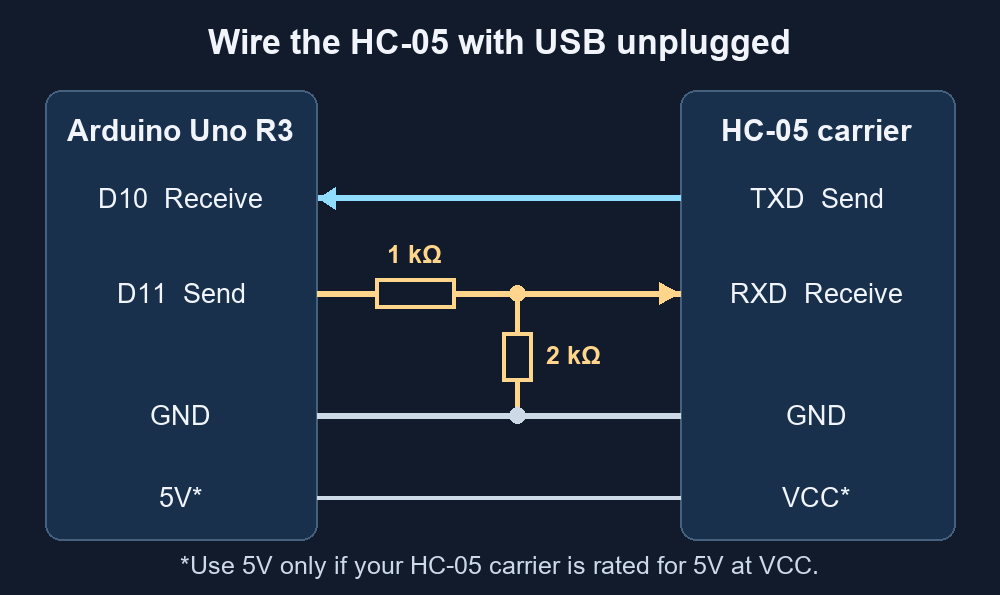

# Use Sinyas with your own Arduino

In this lesson you will turn the Arduino’s built-in light on and off with **A** in Sinyas. Then you will see the stick numbers on your computer. The lesson uses **Generic**, the profile for a project that sends the standard Sinyas replies.

## 1 Gather your parts

| You need | What to look for |
| --- | --- |
| Arduino | **Uno R3** or **classic Nano** with an ATmega328P. The steps use Arduino pin labels **D10** and **D11**. An Uno R4 or Nano Every needs its own setup. |
| Bluetooth module | An **HC-05 Bluetooth Classic serial breakout**. Choose a carrier with labeled **TXD**, **RXD**, **GND**, and **VCC** pins and a wiring sheet from the seller. |
| Two resistors | **1 kΩ** and **2 kΩ**, for the Arduino’s signal into the HC-05. A suitable 5 V to 3.3 V serial level shifter also works. |
| Other parts | Jumper wires, a breadboard, and a USB **data** cable. |
| Phone and computer | Android with [Sinyas installed](./#1-install-sinyas), plus a computer with [Arduino IDE 2](https://www.arduino.cc/en/software). |

Use the **HC-05** for this lesson. Sinyas V1.0 talks to compatible Bluetooth Classic serial devices. An **HM-10** is a Bluetooth Low Energy module and uses a different connection. An **HC-12** is a radio module and does not pair with the phone over Bluetooth.

Ask your teacher to check two details on the HC-05 carrier before you wire it: the voltage allowed on **VCC** and the module’s **data baud rate**, which is the speed it uses to talk to the Arduino. Use a module configured for **38400 baud** to match the sketch. Look up the actual data setting for your module. The speed used in its AT setup mode can be different.

## 2 Wire the module with the power off

**TX** means *send*. **RX** means *receive*. The sender on either board connects to the receiver on the other board. **GND** gives both boards a shared electrical reference.

1. Unplug the Arduino’s USB cable.
2. Connect **HC-05 GND → Arduino GND**.
3. Connect **HC-05 TXD → Arduino D10**. D10 is the Arduino’s receive pin for this sketch.
4. Connect **Arduino D11 → 1 kΩ resistor → HC-05 RXD**. From the **RXD end** of the 1 kΩ resistor, connect the **2 kΩ resistor → GND**. The two resistors lower the Arduino’s 5 V signal to about 3.3 V before it enters RXD.
5. Connect **VCC** only to the supply allowed by your module’s wiring sheet. Use the Arduino’s **5V** pin only when your HC-05 carrier explicitly supports 5 V at VCC.
6. Have your teacher check the wiring before you reconnect USB.

<figure class="guide-figure">
  
  <figcaption><strong>Follow each wire from one end to the other.</strong> The gold joint is where the HC-05 RXD wire and the two resistors meet.</figcaption>
</figure>

  
<h3>Do</h3><ul><li>Cross the send and receive wires.</li><li>Use a shared ground.</li><li>Keep the resistors on the D11-to-RXD wire.</li></ul>

  
<h3>Avoid</h3><ul><li>Changing wires while powered.</li><li>Connecting Arduino D11 straight to a 3.3 V RXD input.</li><li>Connecting motors for the first lesson.</li></ul>

**Check:** The HC-05 should power up. Its indicator pattern depends on the carrier. If the board or module gets hot, unplug USB and have the wiring checked.

## 3 Upload the starter sketch

  <a class="download-item" href="../downloads/sinyas/SinyasArduinoBench/SinyasArduinoBench.ino" download>
    <strong>Download SinyasArduinoBench.ino</strong>Arduino Uno R3 and classic Nano · onboard LED and Serial Monitor
  </a>

1. Save the file in a folder named **SinyasArduinoBench**. Keep the file name **SinyasArduinoBench.ino**.
2. Open the file in **Arduino IDE**. A program you upload to an Arduino is called a *sketch*.
3. Plug in the Arduino with the USB data cable. In the IDE, choose **Tools → Board → Arduino AVR Boards**, then choose **Arduino Uno** or **Arduino Nano** as appropriate. Install **Arduino AVR Boards** from Boards Manager if the menu is missing.
4. Choose the Arduino’s port under **Tools → Port**. If several ports appear, unplug and reconnect the Arduino to see which port changes.
5. Click **Verify**, then **Upload**. If a classic Nano fails to upload, check its **Tools → Processor** setting against the board maker’s instructions. Some use **ATmega328P (Old Bootloader)**.
6. Open **Tools → Serial Monitor**. Choose **115200 baud**. Press the Arduino’s Reset button once if you opened the monitor too late to see the startup message.

**Check:** The monitor should say **Sinyas Arduino bench ready. A controls the onboard LED.** The monitor and the HC-05 use separate connections. Set the monitor to **115200** and the HC-05 data connection to **38400** for the supplied sketch.

**Why D10 and D11?** On an Uno R3 or classic Nano, the hardware serial port on D0 and D1 is shared with USB. This lesson uses software serial on D10 and D11 so you can leave the HC-05 wired while uploading and watching Serial Monitor. If your project board has a spare hardware port such as **Serial1**, use it for the HC-05 and keep the USB monitor separate. Hardware serial is better for receiving commands while sending replies. Check your board’s pinout before moving the wires. [Arduino SoftwareSerial reference](https://docs.arduino.cc/learn/built-in-libraries/software-serial/)

[Arduino’s upload walkthrough](https://docs.arduino.cc/software/ide-v2/tutorials/getting-started/ide-v2-uploading-a-sketch/) · [Arduino’s Serial Monitor walkthrough](https://docs.arduino.cc/software/ide-v2/tutorials/ide-v2-serial-monitor)

## 4 Pair the phone and turn on the LED

1. Open Sinyas. Tap **☰ → Bluetooth → Open Android settings**.
2. Find your **HC-05** in Android Bluetooth settings. Pair it using the PIN for your module if Android asks.
3. Return to Sinyas. Tap **Connect** beside the HC-05. Refresh **Paired devices** if you do not see it.
4. Wait for **Connected** and **Robot replies · Receiving** on the Bluetooth screen. **Generic** is the correct profile for this lesson.
5. Open **Drive** and tap **Start**. After the Arduino answers, tap **A** once. The Arduino’s built-in LED, usually labeled **L**, should turn on. Tap **A** again to turn it off.
6. Turn A on again. Hold **Stop** for **2 seconds**. The LED should go out and **Start** should return.

<figure class="guide-figure">
  
  <figcaption><strong>Look for both signals.</strong> Connected confirms the phone reached the HC-05. Robot replies confirms the Arduino sketch heard the phone.</figcaption>
</figure>

**Check:** You can turn the LED on, off, and stop it from the phone. Next, start the lesson again and disconnect Bluetooth while the light is on. The sketch should turn it off automatically after commands stop arriving.

## 5 Read the signal on your computer

Leave Serial Monitor open at **115200**. Press **Start** in Sinyas, then perform one action at a time and hold it until the next monitor line appears.

| Try this on the phone | Look for this in the monitor |
| --- | --- |
| Release both sticks | **1500/1500** under sticks. |
| Push throttle forward | The first number drops below **1500**. |
| Move steering to the right | The second number rises above **1500**. |
| Tap speed preset 1, 2, or 3 | The **limit** changes to the percentage shown under that button. |
| Turn only A and C on | The **mask** is **5** because A is 1 and C is 4. |
| Hold Stop | The run number becomes **0** while the phone sends idle commands. |

The last values in the monitor show how many valid messages arrived and the longest gap between them. The calculated wheel percentages are practice numbers. This sketch drives the onboard LED only.

## 6 Fix the first thing that fails

| What you see | Try this first |
| --- | --- |
| The Arduino port is missing | Try a known USB data cable and check **Tools → Port** again. |
| Serial Monitor shows strange characters | Set the monitor to **115200**. |
| The HC-05 is missing in the app | Pair it in **Android Bluetooth settings**, grant **Nearby devices** if requested, then refresh the Sinyas device list. |
| Android says Connected but Start stays gray | Check **D10 ← TXD**, **D11 → divider → RXD**, common ground, and the module’s data baud. The Arduino must send its link reply. |
| The LED never changes | Confirm you tapped Start, then **A**, and look for **mask 1** with B and C off. Check the **L** LED, which is separate from the power LED. |
| The link drops and the light turns off | This is also the sketch’s timeout behavior. Check wiring and power if it happens during normal use. |

## 7 Read the messages in your own code

A **frame** is one complete message. Sinyas sends plain text with commas between fields and an asterisk at the end. Read characters into a fixed-size buffer. At each asterisk, check that the frame has the right fields and ranges before using it. A read might contain part of a message or several complete messages.

    DRV,1200,1700,40,5,1*

| Field | Meaning | Example |
| --- | --- | --- |
| Throttle | 1000–2000. Center is 1500. Below center means forward. | 1200 |
| Steering | 1000–2000. Center is 1500. Above center means right. | 1700 |
| Speed limit | 0–100 percent. | 40 |
| Button mask | Add A = 1, B = 2, and C = 4 when they are on. | 5 means A and C. |
| Run ID | 0 means stop. A positive number identifies the current drive session. | 1 |

Use the code as a map. **readCommand()** reads a message. **receiveCommand()** handles Start and Stop. **applyDrive()** updates the LED and the monitor values. **stopOutputs()** turns the LED off and clears the active run.

| What just happened | What the Arduino must do |
| --- | --- |
| A valid idle frame arrives | Stop outputs. Reply with `TEL,LINK,OK*` to tell the phone that the board received a command. |
| A new positive run ID arrives | Start only if the sticks are centered and the buttons are off. Echo the accepted number, for example `TEL,RUN,1*`. |
| Matching drive commands keep coming | Update outputs for that run. Refresh link and run replies about every 250 ms. |
| A valid frame with run ID 0 arrives | Stop immediately. |
| No valid command for 250 ms | Stop outputs, clear the run, and wait for a fresh centered Start. |

### Try a small code change

To make **B** control the light, find the line with **digitalWrite(LED_BUILTIN, buttonA ? HIGH : LOW)** inside **applyDrive()**. Change **buttonA** to **buttonB**, upload the sketch again, reconnect, and try B. Keep **stopOutputs()** as it is so the light still turns off on Stop and timeout.

### Send a value back to the phone

*Telemetry* means a reading sent back to the phone. Optional readings such as `TEL,DIST_CM,23*` or `TEL,BAT,7.40*` can appear on Drive. Send the reading separately from the link and run replies. A custom name uses up to 20 uppercase letters, digits, or underscores. Keep its value under or equal to 96 characters, with no commas or asterisks.

### Move on to your own hardware

After the LED lesson works, use a motor driver appropriate for your project. The sketch’s **leftPower** and **rightPower** are signed percentages. Use them within the driver’s limits. Add the driver’s safe stop behavior to **stopOutputs()**, and test loss of Bluetooth with the wheels raised. For a board with a spare hardware serial port, use that port for the HC-05 so the USB monitor can stay separate. FullVision users can start with the [separate STM32 bench sketch](../downloads/sinyas/SinyasSerialBench.ino).

[Back to Sinyas setup](./)
