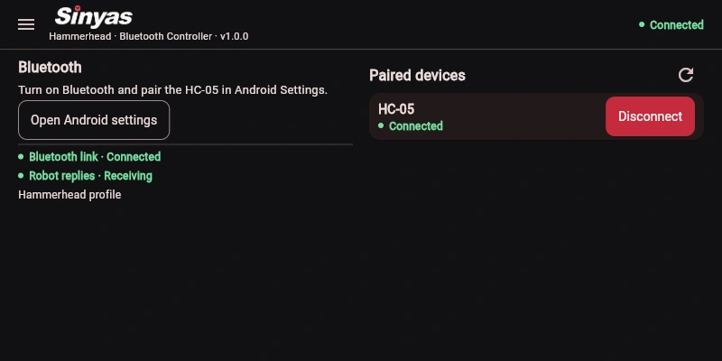

# Hammerhead profile

Use this guide with a Bluetooth-capable Hammerhead running firmware that supports Sinyas. The [Hammerhead kit guides](../hammerhead/) cover the robot and RC hardware. If you are adapting a board yourself, start with the [Generic UART guide](generic.html).

1. Install Sinyas and [pair the HC-05](./#2-pair-the-hc-05-and-connect).
2. Open the robot’s Bluetooth Drive mode. In Sinyas, connect to its paired module and wait for **Hammerhead** under the Sinyas logo.
3. Open **Drive**, select a low speed, and tap **Start**. Check forward, reverse, steering, and the two-second Stop with the wheels raised first.
4. Map and rename **A**, **B**, and **C** only if your Hammerhead firmware implements an accessory for those bits. The firmware defines what each bit does.

<figure class="guide-figure">
  
  <figcaption><strong>Hammerhead identification.</strong> The profile comes from the robot's firmware reply. V1.0 provides Drive for this profile.</figcaption>
</figure>

If the robot reports only the standard link and run replies, Sinyas can use it as **Generic**. The profile reply for a compatible Hammerhead is `TEL,INFO,Hammerhead/DRIVE*`. A Bluetooth connection with no link reply cannot start Drive.

[Back to Sinyas setup](./)
