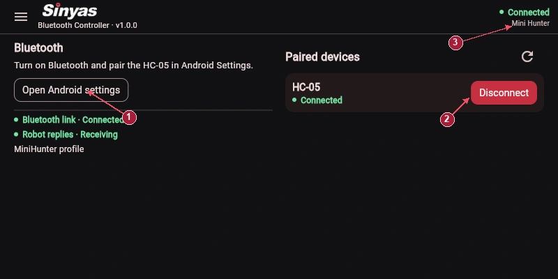
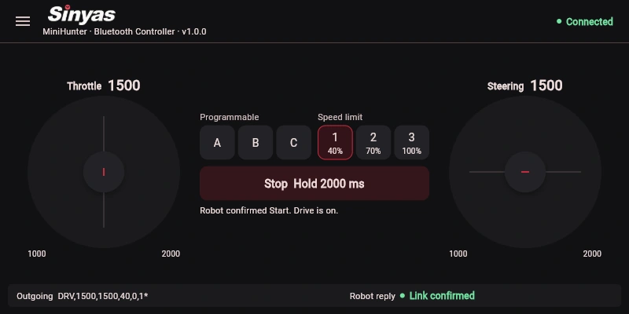
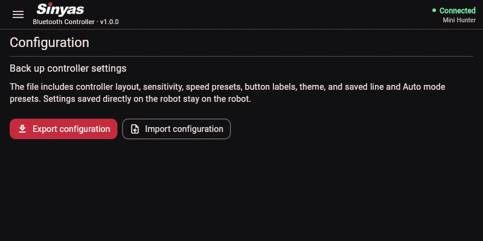

      
      
    

# Sinyas Bluetooth Controller

Sinyas is a landscape Android controller from Twentynine Robotics. Pair an HC-05, drive with two thumbs, and use the controls your robot firmware supports.

  <a class="download-item" href="../downloads/sinyas/sinyas-v1.0.0.apk" download>
    <strong>Sinyas V1.0 Initial Release</strong>
    Signed Android APK · 49.2 MiB
  </a>

  <section>
    <h2>Choose your setup</h2>
    <a class="directory-link" href="controller-reference.html"><strong>Controller screen reference</strong><small>Every phone screen, setting, status, backup, and diagnostic control.</small>→</a>
    <a class="directory-link" href="mini-hunter.html"><strong>Mini Hunter</strong><small>Drive, sensor tuning, opening drafts, and flag servo tests.</small>→</a>
    <a class="directory-link" href="enemy-tuning.html"><strong>Enemy Detection Tuning</strong><small>Choose between Classic and PID Beta, test the controls, and save supported settings.</small>→</a>
    <a class="directory-link" href="hammerhead.html"><strong>Hammerhead</strong><small>Connect a Bluetooth-capable Hammerhead and use Drive.</small>→</a>
    <a class="directory-link" href="generic.html"><strong>Generic and custom projects</strong><small>Wire an HC-05 to an Arduino Uno or classic Nano and control its LED.</small>→</a>
  </section>

<strong>Before testing a robot:</strong> secure it on a stable stand with wheels and attachments clear. Verify Stop and link loss while the drive wheels are raised.

[APK SHA-256 checksum](../downloads/sinyas/sinyas-v1.0.0.apk.sha256)

## 1 Install Sinyas

You need **Android 7.0 or later** and a compatible Bluetooth Classic serial module. V1.0 uses the HC-05.

1. Download the signed APK above or use the official copy supplied by Twentynine Robotics.
2. Open it in Android and follow the installation prompts. If Android asks to allow installs from the app that opened the file, enable it for that source.
3. Open Sinyas and allow **Nearby devices** if Android prompts. The app opens in landscape.
4. If you already used Sinyas beta, install over it so Android can keep your existing settings. You can also export a backup first.

## 2 Pair the HC-05 and connect

1. Power the robot and open the robot-side Bluetooth Drive mode. Turn on Bluetooth on Android.
2. In Sinyas, open **Menu → Bluetooth → Open Android settings**. Pair with the HC-05 there using the PIN configured on your module.
3. Return to Sinyas. Refresh **Paired devices** if the module is missing, then choose **Connect** beside the correct device.
4. Wait for the profile shown under the Sinyas logo. The Bluetooth socket and the board's own reply are shown separately. The module's name identifies the paired device. The firmware reply identifies the robot.

<ol>
  <li><strong>Pair in Android settings</strong> → the module appears under Paired devices.</li>
  <li><strong>Connect in Sinyas</strong> → Bluetooth link shows Connected.</li>
  <li><strong>Wait for the robot reply</strong> → the profile appears below Connected.</li>
  <li><strong>Open Drive</strong> → Start becomes available after the robot confirms the Drive link.</li>
</ol>

<figure class="guide-figure">
  
  <figcaption><strong>Bluetooth connection.</strong> Use Open Android settings to pair. Find the paired module on the right. The profile appears under the Sinyas logo. App screenshots in this guide use simulated robot data.</figcaption>
</figure>

## 3 Drive and stop

1. Open **Menu → Drive**, select the lowest speed preset, and tap **Start**.
2. Wait for the board to accept the run. Use one stick for throttle and the other for steering. Both sticks can be used at once. Releasing a stick returns it to center.
3. Buttons **1**, **2**, and **3** select speed limits. **A**, **B**, and **C** toggle accessory bits. Your robot firmware determines what they do.
4. Hold **Stop** for **2 seconds** until the bar fills. The app sends a stop at the beginning of the hold. On Mini Hunter Bluetooth Drive, a completed hold also requests a return to the board menu.

<figure class="guide-figure">
  
  <figcaption><strong>Drive controls.</strong> The sticks sit on either side. Speed presets, accessory buttons, and Stop sit between them.</figcaption>
</figure>

## 4 Customize the controller

Stop Drive before opening **Menu → Setup**. Set your throttle side, pad size, speed-button position, and independent throttle and steering curves or sensitivity. Edit presets **1–3** as 0–100% limits. Rename **A–C** to match your robot. Each renamed button keeps its original signal bit. Under **Theme**, choose the appearance and highlight color. Settings stay on this phone.

From **Menu → Configuration**, use **Export configuration** to create a JSON backup. **Import configuration** asks before replacing the settings on this phone. The backup includes controller settings and supported phone presets. Settings already stored on the robot must be read or saved through the matching tuning tool.

<figure class="guide-figure">
  
  <figcaption><strong>Phone backups.</strong> Export before replacing your settings or moving to a different phone.</figcaption>
</figure>

## Diagnose a connection

| What you see | What to check |
| --- | --- |
| HC-05 missing from the list | Turn on Android Bluetooth, grant Nearby devices, pair in Android settings, then refresh Paired devices. |
| Connected but Start is disabled | Confirm the UART wiring, common ground, data baud, and robot-side Drive mode. Start waits for a firmware reply. |
| Generic appears for a Mini Hunter | Confirm the board has compatible firmware and is in a supported Bluetooth or calibration tool. Reconnect and watch identification on the Bluetooth page. |
| A–C change in the app but nothing happens on the robot | Verify that your firmware maps the corresponding bits to an accessory. |
| Drive or testing stops unexpectedly | Check power, serial timing, and calibration safeguards. Open **About → Diagnostics** to review or copy a local log. |

Use **Menu → Guide** for a quick protocol reference. The [Arduino and Generic guide](generic.html) starts with an LED lesson, then explains the messages behind it.
