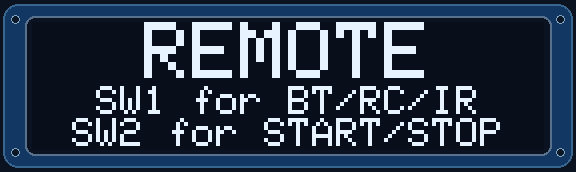
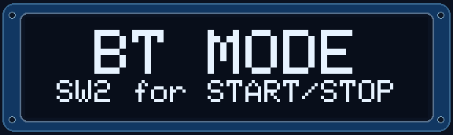
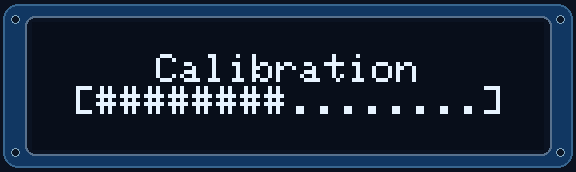
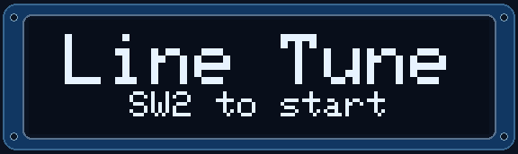
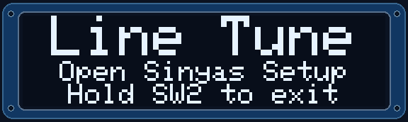
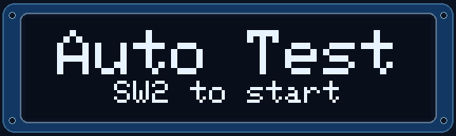
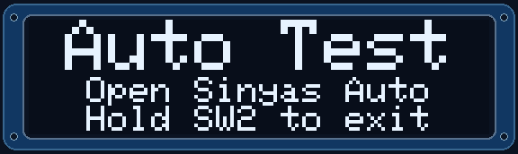
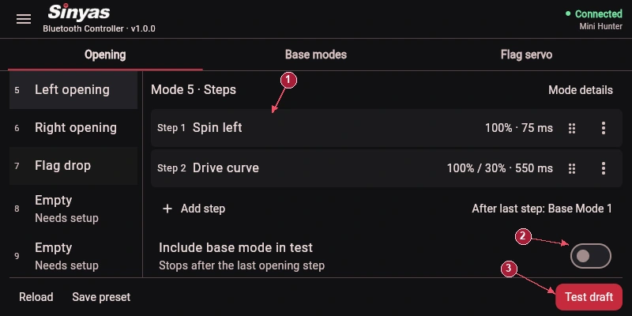

# Use Sinyas with Mini Hunter

Start with the driving lesson. Once you can connect, drive, and stop, try the calibration lessons one at a time.



## 1 Get your equipment ready

- **Phone:** Android with [Sinyas installed](./#1-install-sinyas).
- **Robot:** Mini Hunter with an HC-05 and the matching **MiniHunterV2.8_Advance** program on its FullVision board. The program inside the board is called *firmware*. Ask your teacher or Twentynine Robotics which firmware your kit has.
- **Test stand:** A stable support that keeps both wheels and attachments clear. Have a teacher help with the first powered test.

| What you see | What it means |
| --- | --- |
| OLED | The little screen on the robot. |
| MODE | The switch that chooses between Remote and Auto. |
| SW1 | The board button that moves to the next menu choice. |
| SW2 | The board button that opens a choice. During a tool, hold it for two seconds to exit. |

<strong>Set the robot on its stand before connecting.</strong> Keep fingers, cables, and loose clothing clear. In a tuning test, even 0% forward speed can allow the wheels to turn in place.

The blue OLED illustrations below are simulations of the **MiniHunterV2.8_Advance** screens. They use the firmware’s [bitmap font](../assets/images/sinyas/oled/FONT-LICENSE.txt).

## 2 Put the robot in Bluetooth Drive

1. Switch the robot on while it is on the stand.
2. Move the **MODE** switch until the OLED shows **REMOTE**.

    <figure class="guide-figure guide-figure--compact step-figure">
      
      <figcaption>The Remote menu shows what SW1 and SW2 do.</figcaption>
    </figure>

3. Tap and release **SW1** until you see **BT MODE**.

    <figure class="guide-figure guide-figure--compact step-figure">
      
      <figcaption>BT MODE is selected.</figcaption>
    </figure>

4. Tap and release **SW2**. The OLED should say **Waiting for Sinyas**.

    <figure class="guide-figure guide-figure--compact step-figure">
      
      <figcaption>The board is ready for the phone.</figcaption>
    </figure>

**Check:** When the robot says **Waiting for Sinyas**, it is ready for the phone. If you see **AUTO** or a numbered mode, return the MODE switch to **REMOTE**.

## 3 Pair the phone, then connect in Sinyas

1. In Sinyas, tap **☰ → Bluetooth → Open Android settings**.
2. Turn Bluetooth on. Pick the HC-05 from the list of nearby devices and enter the PIN configured for your robot if asked. This pairing step is normally needed once.
3. Return to Sinyas. If the module does not appear under **Paired devices**, tap the refresh icon.
4. Tap **Connect** beside your HC-05.

    <figure class="guide-figure guide-figure--compact step-figure">
      
      <figcaption>The HC-05 shows Connected in the paired-device list.</figcaption>
    </figure>

5. Check the upper-right corner. **Connected** means the phone has reached the Bluetooth module. **MiniHunter**, under the Sinyas logo, means the robot’s program has also identified itself.

    <figure class="guide-figure guide-figure--compact step-figure">
      
      <figcaption>The board has received data from Sinyas.</figcaption>
    </figure>

**Check:** Wait for **MiniHunter** before looking for the tuning tools. If the screen stays on **Generic**, check the OLED, confirm the firmware, then disconnect and reconnect. The HC-05 name alone does not tell Sinyas which robot is connected.

## 4 Learn the controls on the stand

1. Tap **☰ → Drive**. Wait for **Start** to turn on.
2. Choose speed button **1**. If its limit is higher than your teacher wants, change it under **Setup → Speed presets** while Drive is stopped.
3. Tap **Start**. Wait until the app says the robot accepted the run.

    <figure class="guide-figure guide-figure--compact step-figure">
      
      <figcaption>When Drive is on, use the sticks, speed buttons, or Stop.</figcaption>
    </figure>

4. Move the **throttle** stick a little forward, then release it. Check that the wheels turn in the correct direction and stop when the stick centers.
5. Move the **steering** stick slightly left, then right. Release it after each check. Try both sticks together once you know what each one does.
6. Press and hold **Stop** for **2 seconds**, until the bar fills. The app sends the stop when the hold starts. Finish the hold so the app unlocks its menu and the robot can return to its board menu.

**Check:** The wheels stop, **Start** returns on the app, and the Mini Hunter returns to its menu after confirming the exit. Open **BT MODE** again with SW2 before the next Drive session. Buttons **A**, **B**, and **C** only operate an accessory if your robot's program assigns something to them.

## 5 Open a calibration tool

*Calibration* means checking a sensor or adjusting how the robot reacts. Stop Drive first. At the board’s normal menu:

1. Press and hold **SW1 and SW2 together**. Watch the calibration progress bar fill.

    <figure class="guide-figure guide-figure--compact step-figure">
      
      <figcaption>The bar fills while Calibration opens.</figcaption>
    </figure>

2. Release both buttons when the board reaches **CAL MODE**.

    <figure class="guide-figure guide-figure--compact step-figure">
      
      <figcaption>CAL MODE is open.</figcaption>
    </figure>

3. Tap **SW1** until the OLED shows the tool name in the table below.
4. Tap **SW2** to enter the tool. Open the matching app screen and wait for its board-ready message or live readings.
5. When you are finished, hold **SW2 for 2 seconds**. Releasing early cancels the exit hold.

    <figure class="guide-figure guide-figure--compact step-figure">
      
      <figcaption>Release SW2 when the bar is full to return to the tool menu.</figcaption>
    </figure>

| What you want to try | OLED label | Phone menu |
| --- | --- | --- |
| Detect the white boundary | **Line Tune** | **Line Detection Tuning** |
| Make the robot drive straight | **Modes Tune** | **Wheel Alignment** |
| Turn toward another robot | **Enemy Tune** or **PID Tune** | **Enemy Detection Tuning** |
| Rehearse the first movements | **Auto Test** | **Auto modes → Opening** |
| Check the flag by itself | **Auto Test** | **Auto modes → Flag servo** |

## 6 Check the line sensors before changing movement

A line sensor measures the surface underneath it. The **Pot** value comes from the small adjustment screw on the board, called a potentiometer. It sets the number that separates the floor from the line.

1. From **CAL MODE**, tap **SW1** until you see **Line Tune**.

    <figure class="guide-figure guide-figure--compact step-figure">
      
      <figcaption>Line Tune is selected.</figcaption>
    </figure>

2. Tap **SW2** to open **Line Tune**.

    <figure class="guide-figure guide-figure--compact step-figure">
      
      <figcaption>Open Sinyas Setup is the wording on the board. The phone screen is called Line Detection Tuning.</figcaption>
    </figure>

3. Open **Line Detection Tuning** on the phone. Leave the test stopped. Put a piece of the normal arena surface under the left sensor and observe **ADC**, **Pot**, and the status. Then show it the white line.

    <figure class="guide-figure guide-figure--compact step-figure">
      
      <figcaption>Read both sensors on the phone before starting a movement test.</figcaption>
    </figure>

4. With your teacher, adjust the left pot so the floor reads **Clear** and the white line shows a hit. On this firmware, a sensor number lower than the pot number counts as a hit. Repeat on the right.
5. Test one side at a time, then both, to check the app reacts to the correct sensor.

**Optional OLED check.** From CAL MODE, tap SW1 once to see which side detects the line.

<figure class="guide-figure guide-figure--compact step-figure">
  
  <figcaption>In this example, the left side detects the line and the right side is clear.</figcaption>
</figure>

### Adjust the robot’s response to the line

1. Pick **1 kg** or **3 kg** from the **Line profile** dropdown at the bottom. The profile loads recovery settings across all four tabs. To store your own settings on the phone, pick one of the three **Custom** slots, edit the settings, then use the pencil beside the dropdown to name and save the slot.
2. Open **Left**, **Right**, or **Both**. Pick the tab for the sensor condition you want to tune.
3. Change one field at a time. **Reverse power** controls how hard it backs away. **Minimum reverse** controls the minimum backing time. **Turn power** and **Turn time** control the turn that follows. **1000 ms** is one second.
4. Leave **Shared** alone on your first run. Those settings affect all three recovery tabs, including how quickly reverse power rises and how long the robot waits for the line to clear.
5. Start on the stand with **Forward speed** at **0%** and trigger each sensor with a sample of the line. When supervised on the test surface, increase forward speed gradually. Use **Stop test** before picking up the robot or saving.
6. Choose **Save to robot** to write the displayed settings to the board. **Load from robot** reads the board's saved values.

**Check:** A left hit and a right hit should produce different escape turns. Each sensor should still report floor and line correctly. This tool uses the line sensors without target tracking.

### Look up the Shared settings

Change these after you have checked Left, Right, and Both. They apply to all three recovery cases.

| Field | What it changes |
| --- | --- |
| **Initial reverse (%)** | How much reverse power the robot uses when the ramp begins. |
| **Reverse ramp (ms)** | How long it takes to build up to the reverse power for that case. |
| **Neutral pause (ms)** | A short pause at zero motor output before reversing and again before turning. |
| **Line clear time (ms)** | How long both sensors must stay clear before the robot can finish backing up. |
| **Reverse limit (ms)** | The longest the robot may reverse before it stops the test. Make it at least as long as the clear time and each minimum reverse time. |
| **Settle time (ms)** | How long the robot waits after the recovery turn before continuing. |

If the app reports the recovery limit, stop and check the placement and sensor readings. A larger time value will not fix a sensor that still sees the line after the robot has moved away.

## 7 Practice turning toward a target

Open **CAL → Enemy Tune** or **PID Tune** on the board. Older firmware labels Classic **Enemy Detection**. Then open **Enemy Detection Tuning** in Sinyas. Choose **Classic** for fixed turn power and a turn delay you can set. Choose **PID** to try steering power that changes as the target moves. **PID is in beta.** Try both on your own robot and keep the one that behaves best for you.

The [full enemy tuning lesson](enemy-tuning.html) explains how to read the sensors, adjust each method, compare the results, and save the supported settings.

## 8 Build and test your first opening

An *opening* is a short list of moves that plays in order. The *base mode* is what the robot can do after the last move.

1. From **CAL MODE**, tap **SW1** until you see **Auto Test**.

    <figure class="guide-figure guide-figure--compact step-figure">
      
      <figcaption>Auto Test is selected.</figcaption>
    </figure>

2. Tap **SW2** to open the tool. On the phone, open **Auto modes → Opening**.

    <figure class="guide-figure guide-figure--compact step-figure">
      
      <figcaption>The board stays on Auto Test during both opening and flag tests.</figcaption>
    </figure>

3. Pick slot **8** if it is empty, or select any slot marked **Needs setup**. Slots 5–7 contain example presets. Use **Mode details** to enter a short name such as **First turn**.
4. Tap **Add step**. Choose **Spin left**, enter **20%** power and **200 ms**, then tap **Apply step**.
5. Add **Wait** for **500 ms**. Open the three-dot menu on a step and choose **Move up** or **Move down** to change its order. If you try **Drive curve** later, give the left and right wheels different power values.

    <figure class="guide-figure guide-figure--compact step-figure">
      
      <figcaption>The example shows a draft with two steps and the base-mode test switch.</figcaption>
    </figure>

6. Check **After last step**. Leave **Include base mode in test** switched **off**. Tap **Test draft** and watch the short spin and pause. The wheels should then stay stopped.
7. If you want to see a handoff later with your teacher, select a base mode, lower its no-target speed in **Base modes**, and turn the switch on. Tap **Stop test** to finish. A line hit or command loss can also end the test.
8. Use **Save preset** to keep a copy on the phone. On boards that support saving, find this under **Phone presets**. Follow the steps below to save a mode you want to run from the OLED.

**Check:** With the switch off, **Opening complete. Robot stopped.** should appear after the last step.

### Save an opening to the robot

Use the current Sinyas APK and matching **MiniHunterV2.8_Advance** firmware. Check [Sinyas releases](releases.html) for app versions. Ask Twentynine Robotics for the firmware if your kit still has an earlier build.

1. Leave the board in **CAL → Auto Test**. In Sinyas, stay on **Auto modes → Opening** and select the slot you want to change.
2. Stop the draft test. Tap **Save to robot** and wait for **Mode 5 saved to robot**, or the number you selected.
3. Tap **Load from robot** to check what the board saved. The app fills the opening steps, base mode and power, and flag angles from that slot.
4. Hold **SW2** to leave the tool, then leave CAL. Select the saved number in the robot’s **AUTO** menu. The opening runs first, then the selected base mode takes over. Verify the sequence after restarting the board.

Slots **5–7** use their built-in modes until you save a replacement. Slots **8–10** show **Empty - use Sinyas** until you program them. Names and descriptions stay on the phone. The OLED uses the mode number. The **Include base mode in test** switch is for draft testing. A saved opening hands off to its chosen base in normal Auto. A line hit interrupts the opening and starts the normal recovery.

If the app only offers **Save preset**, check [Sinyas releases](releases.html) for the current app version and confirm that the board has compatible firmware.

### Look up the Opening and Base modes controls

| Control | What it does |
| --- | --- |
| **Mode details** | Edit the phone preset’s name and description. Names allow up to 24 characters and descriptions up to 120. |
| **Add step** | Pick Move forward, Move backward, Drive curve, Spin left, Spin right, Drop flag, or Wait. You can keep up to eight steps. Movement and wait times are in milliseconds. Drop flag is a single action with no time field. |
| **Step card** | Tap it to edit. Use its three-dot menu to move it up, move it down, or remove it. |
| **After last step** | Choose the base mode for the handoff. **Include base mode in test** decides whether the test actually uses it. |
| **Base modes** | See what each numbered base does when no target is found. Set its draft power from 0% to 100%. Base 1 creeps forward, Base 2 spins left, Base 3 spins right, and Base 4 searches forward. |
| **Reload** | Return to the phone’s saved preset values. On boards that support saving, choose Reload phone preset in Phone presets. |
| **Save preset** | Keep a copy on the phone. Use Save to robot to write the selected opening slot to a compatible board. |

## 9 Test the flag without driving

1. Keep the robot in **CAL → Auto Test** and change to **Auto modes → Flag servo** in Sinyas.
2. Enter the **Closed angle** and **Open angle** in degrees. Start from the kit’s known angles. Change one angle in small steps so the flag does not hit its mount.

    <figure class="guide-figure guide-figure--compact step-figure">
      
      <figcaption>The two angles are above the Test servo button.</figcaption>
    </figure>

3. Tap **Test servo**. The flag opens and returns to the closed angle. The drive wheels stay stopped.
4. Use **Save preset** to remember the angles on this phone.

**Check:** The flag moves freely in both directions. **Servo test complete.** means the board finished the test.

The OLED stays on **Auto Test** during the servo test. Look for **Servo test complete** on the phone.

## Wheel alignment

Use Wheel Alignment if the robot pulls to one side when you tell it to drive straight. The robot can remember a different correction for each test speed.

1. Connect Sinyas to a Mini Hunter with the matching firmware. On the board, open **CAL → Modes Tune**. On the phone, open **Wheel Alignment** and tap **Load from robot**.
2. Put the robot on a clear, flat test surface with room to stop. Pick **Low · 25%**, then tap **Start**. Watch which way the robot drifts and tap **Stop**.
3. If the robot drifts left, use **+** to slow the right wheel. If it drifts right, use **−** to slow the left wheel. Each tap changes the trim by 0.5 percentage points. You can also type a value such as `+1.5` or `-1.5`. Use `0.0` for equal power.
4. Repeat until it drives straight. Then test **Medium · 50%** and **High · 80%** if you have room to run at those speeds.
5. Tap **Stop**, then **Save to robot**. The saved trim applies to forward driving in RC and Auto. The robot also stops the test if it sees a line or loses commands from the phone.

## Keep the robot ready for the next student

  
<h3>Do</h3><ul><li>Start on a stand and test Stop early.</li><li>Change one tuning value at a time.</li><li>Record or load the original values before saving a change.</li></ul>

  
<h3>Avoid</h3><ul><li>Lifting the robot during a test.</li><li>Starting an opening with the base-mode switch on for the first rehearsal.</li><li>Assuming a phone preset changes the robot’s onboard modes.</li></ul>

## If a step does not work

| Symptom | What to check first |
| --- | --- |
| **Connected** but **Start** is gray | Make sure SW2 opened **BT MODE**, then check the Robot replies indicator on the Bluetooth screen. |
| You cannot find Auto modes or the tuning pages | Wait for **MiniHunter** under the Sinyas logo and check that your board reports the matching features. |
| A calibration button is gray | Open the matching tool on the OLED and wait for the app to confirm it. |
| The test stops as soon as it starts | Check whether a line sensor is already seeing the boundary or the Bluetooth link dropped. |
| The buttons still look right after changing a preset, but the robot acts differently | Check where it was saved. Phone presets live on the phone. Compatible Auto slots, line settings, and tracker settings use **Save to robot** in their respective tools. |

If the OLED says **SIGNAL LOST**, check the phone’s Bluetooth link before starting again.

<figure class="guide-figure guide-figure--compact step-figure">
  
  <figcaption>The board stopped receiving Drive commands.</figcaption>
</figure>

[Back to Sinyas setup](./)
