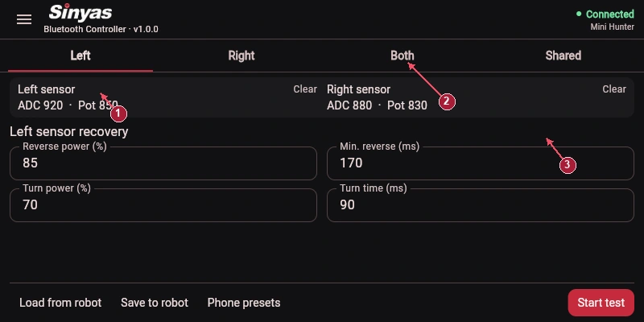
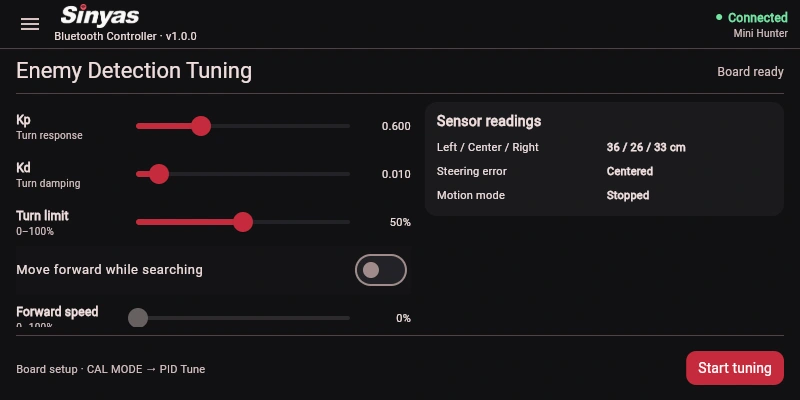
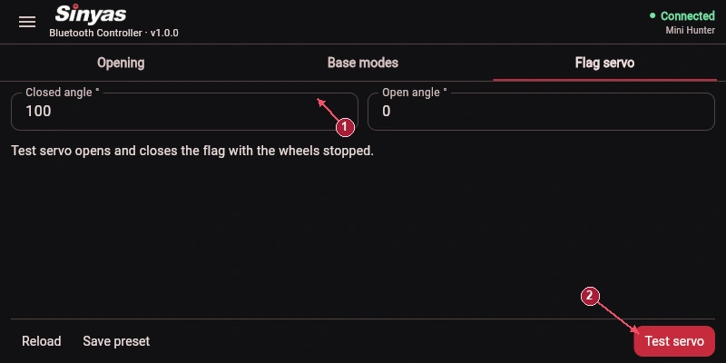

# Mini Hunter profile

Use Sinyas V1.0 with the matching **MiniHunterV2.8_Advance** firmware on your FullVision-STM32 board. Contact Twentynine Robotics if you need the firmware for your kit. Start with [Android installation and pairing](./#1-install-sinyas).

## 1 Confirm Mini Hunter and Drive

Select the robot’s Bluetooth mode before starting Drive. The app starts on **Generic**, then shows **Mini Hunter** under the connection status after the firmware identifies itself. Open the menu to find **Auto modes**, **Line Detection Tuning**, and **Enemy Detection Tuning** when supported by the board. A paired HC-05 alone cannot identify the kit.

On the robot, **SW1 + SW2** enters **CAL MODE** from the mode selector. Scroll to the named tool with **SW1** and tap **SW2** to enter. Hold **SW2** for two seconds to leave a tool. CAL returns to the tool’s menu entry. A released hold resets the exit progress.

| Goal | Robot OLED | Sinyas |
| --- | --- | --- |
| Drive | Bluetooth mode | **Drive** |
| Read line sensors and tune recovery | **CAL → Line Tune** | **Line Detection Tuning** |
| Test Classic or PID tracking | **CAL → Enemy Detection** or **PID Tune** | **Enemy Detection Tuning** |
| Test an opening or the flag servo | **CAL → Auto Test** | **Auto modes** |

<strong>Start with the wheels clear.</strong> A tuning run at 0% forward can still turn the wheels. Use a controlled test area for floor tests and keep the robot's power control accessible.

## 2 Read and tune line detection

1. Open **CAL → Line Tune** on the board. In Sinyas, open **Line Detection Tuning**.
2. Wait for **Live sensor readings**. Compare each side’s **Sensor** value to its **Pot** value. Adjust the matching physical potentiometer and verify the status over both the arena floor and the boundary. The board treats a sensor value below its pot as a line hit.
3. Open **Left**, **Right**, or **Both** to adjust the response for those hits. **Reverse power** and **Turn power** are percentages. **Minimum reverse** and **Turn time** are in milliseconds. **Shared** contains ramp and recovery timings, including the limits that govern clearing the line.
4. Start the line test at 0% forward, then raise it gradually when ready. This test uses the line sensors without enemy tracking. Valid changes apply to the next recovery.
5. Stop the test before saving. **Save to robot** writes the supported line recovery settings to the robot. **Load from robot** reads the robot’s stored values. **Phone presets** keeps named copies that can be reused on a different robot.

<figure class="guide-figure">
  
  <figcaption><strong>Calibrate in this order.</strong> ① compare live readings. ② choose the hit condition. ③ adjust its power and timing.</figcaption>
</figure>

## 3 Tune enemy detection

1. Open **CAL → Enemy Detection** or **PID Tune**, depending on the board’s saved tracker. Open **Enemy Detection Tuning** in Sinyas and wait for the board.
2. Choose **Classic** for fixed turning power and optional turn delay, or **PID** for steering based on the sensor error. The board shows the front sensor readings and can report the outer pair on supported five-sensor builds.
3. Press **Start tuning**. The default 0% forward leaves tracking free to pivot. Start gently, consider changing one setting at a time, and watch how consistently the robot centers a target. **Move forward while searching**, when supported, uses the selected forward power when the target disappears.
4. Stop the test, then use **Save to robot** for the tracker choice and Classic settings supported by the firmware. PID live gains are session values. Auto uses the gains compiled in the firmware. Use the board’s calibration pages to check raw distance readings if tracking begins closer than expected.

<figure class="guide-figure">
  
  <figcaption><strong>Enemy Detection Tuning.</strong> Begin with forward speed at 0% and use the sensor readings to interpret the response.</figcaption>
</figure>

## 4 Build and test an opening

1. On the robot, open **CAL → Auto Test**. In Sinyas, open **Auto modes → Opening**.
2. Choose a phone slot from **5–10**. Slots 5–7 have example presets. Empty slots display **Needs setup**. Use **Mode details** to edit the name and phone description.
3. Use **Add step** to pick a movement, a flag drop, or a wait. Power is 0–100%. Duration uses milliseconds, so **1000 ms = 1 second**. A **Drive curve** needs different left and right power values. Drag the handle next to a step to reorder it.
4. Choose the base mode under **After last step**. Leave **Include base mode in test** off to run the opening only. Turn it on when you intentionally want the robot to continue into the selected base mode.
5. Tap **Test draft**. The draft runs from RAM. **Stop test**, a line hit, or loss of commands also ends the test. Save with **Save preset** if you want to keep it on the phone.

**Base modes** adjusts the no-target speeds used during a draft's base handoff. **Flag servo** supplies the angles for the draft. Phone presets and test settings do not install new opening slots or replace the robot’s existing competition modes.

<figure class="guide-figure">
  
  <figcaption><strong>Opening test sequence.</strong> ① arrange steps. ② choose whether the test continues into the base mode. ③ run the draft.</figcaption>
</figure>

## 5 Check flag servo angles

Keep the board in **CAL → Auto Test**, then open **Auto modes → Flag servo**. Enter the **Closed angle** and **Open angle** in degrees. Tap **Test servo** to open then return to the closed angle with the wheels stopped. It uses the values currently on screen. Use **Save preset** to keep the angles on the phone.

<figure class="guide-figure">
  
  <figcaption><strong>Test the flag on its own.</strong> ① set the angles. ② tap Test servo and confirm that the mechanism has clearance.</figcaption>
</figure>

[Back to Sinyas setup](./)
